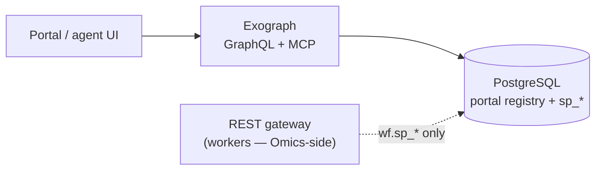

# GoliathApp deploy targets

Provider-neutral target descriptors live under `deploy/targets/`. They describe how to wire **PostgreSQL**, the **portal** semantic client, and the optional **Exograph** GraphQL/MCP façade. Workflow **workers** and the REST **gateway** fleet stay in descendant stacks (for example GoliathOmics `goliath-test`); this repository does not provision GPUs or worker pods.

| Target | Purpose |
|--------|---------|
| `goliath-exo` | Platform semantic read stack: PostgreSQL + portal procedures + Exograph/MCP |
| `goliath-exo.example.json` | Sanitized template (copy and fill secrets) |

## goliath-exo stack shape

1. Apply GoliathApp schema (`workflow_engine/sql_pg/apply_schema.sh`) and seed semantics (`seed_semantic_catalog.py`).
2. Create `goliath_portal` / `goliath_gateway` roles (`database_gateway_roles.sql`).
3. Install Exograph from the offline bundle (`scripts/fetch_third_party.py` or `scripts/assemble_release.sh`).
4. Run `exo-server` with `EXO_POSTGRES_URL` (read-only; `sslmode=verify-full`) and JWT aligned with `portal.sp_session_open`.
5. Enable MCP profile `semantic_read` (see `exo/exo.toml`).

Use `deploy/scripts/deploy_goliath_exo.sh` as a checklist driver; adapt SSH/systemd sections to your host or container platform.
