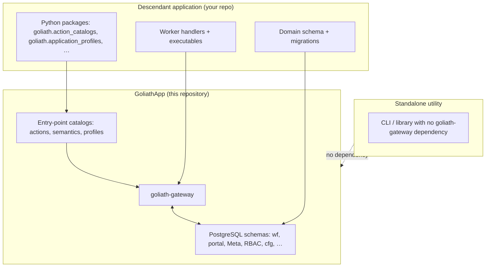
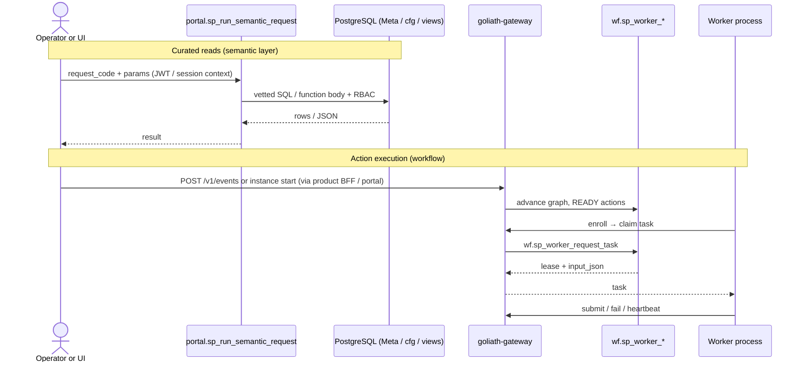
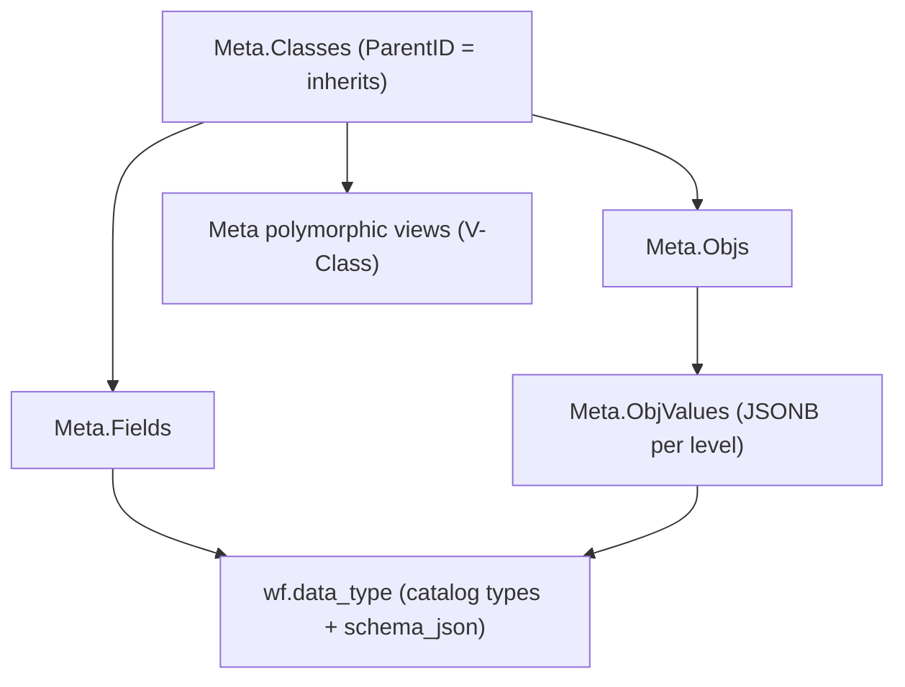
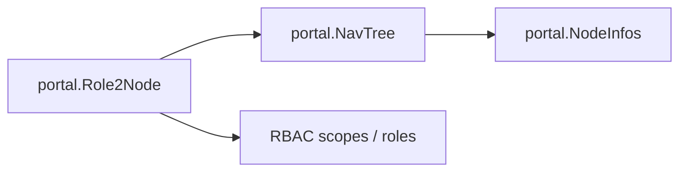
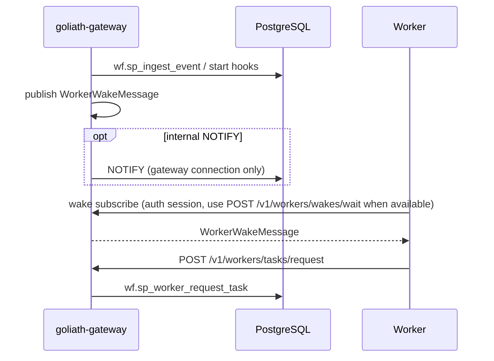

# Architecture overview

GoliathApp is a **database-governed platform**: workflow state, RBAC, semantic definitions, Meta classes, and portal navigation live in PostgreSQL; **`goliath-gateway`** exposes the worker REST API; optional façades (for example Exograph) call the same `portal.sp_*` entry points as application code. This page orients adopters before the deeper topic guides.

## Worker isolation (non-negotiable)

**Workers never open PostgreSQL.** They use **only** the gateway HTTP API (`contracts/openapi.yaml`): enrollment, session, **optional wake subscription (gateway-mediated)**, **claim** (`POST /v1/workers/tasks/request`), heartbeat, submit, fail. **Event-triggered wakes** are produced after gateway-side ingest/start; workers must receive them **through the gateway** on an authenticated channel — **not** via `LISTEN` on a worker-held DSN. Legacy `PostgresWorkerWakeSubscriber` is documented as **superseded** in [dual-activation.md](dual-activation.md).

## Platform, descendant application, standalone utility

The platform repository **does not import or branch on** any specialized product. You integrate at **data** (SQL apply + seeds), **Python entry points** (installed alongside `goliath-gateway`), and **deployment** wiring.

Worker hosts talk **only** to `goliath-gateway` (thick arrow). They do **not** hold `PGHOST` / `PGDATABASE` for wakes or claims.

- **Platform** — Neutral mechanics: workflow engine, actions as rows, worker enrollment, semantic runner, Meta model, portal shell, inventory module, schema apply order, contracts in `contracts/openapi.yaml`.
- **Descendant application** — Adds domain tables, semantic namespaces, `ActionSpec` rows at `ActionLevel.DOMAIN`, NavTree nodes, optional Meta classes, worker processes, and (when needed) a `goliath.application_profiles` module so pipeline profile resolution can load JSON from your layout.
- **Standalone utility** — A tool that does **not** depend on `goliath-gateway` or the platform database. It may sit beside the stack (for example upstream bioinformatics CLIs) and feed artifacts that workflows or operators consume.

## Request → semantic layer → gateway → worker

Read paths use the **semantic registry** (`portal` tables + `portal.sp_run_semantic_request`). Write paths that lease work use **wf** + **`goliath-gateway`**.

The gateway **does not** resolve domain catalogs at claim time: `input_json` is what the database returns ([platform.md](platform.md), [workers.md](workers.md)).

## Meta classes, inheritance, and views

Meta is a **single-inheritance class model** with JSONB `ObjValues` per inheritance level, generated **JSON Schema** (draft 2020-12) as `wf.data_type` catalog entries, and polymorphic views `"Meta"."V<Class>"`. Optional **`pg_jsonschema`** validation is controlled per class (`PgValidate` / `goliath.meta_pg_validate`); Pydantic validation is available in Python (`goliath_app/meta/validation.py`). See [meta-model.md](meta-model.md).

New nodes register through **`portal/NavNode`** Meta objects and the hierarchical **`Parent`** link; legacy **`portal."NavTree"`** + **`Role2Node`** remain for RBAC compatibility ([nav-tree-meta.md](nav-tree-meta.md)).

## NavTree extension

Portal navigation is **relational**: nodes in `portal."NavTree"`, entitlements via `portal."Role2Node"`. Applications register nodes with `portal.sp_nav_register_node` (`workflow_engine/sql_pg/portal_shell_schema.sql`). Semantic entities may attach **NavBinding** metadata for UX integration ([semantic-layer.md](semantic-layer.md)).

## Dual activation (wake + claim)

Workers **own** work only through **`POST /v1/workers/tasks/request`**. Optional **wake** hints shorten idle time after events or starts: the **gateway** publishes wakes (internal implementation may use Postgres `NOTIFY` or other transport); workers **receive wakes only through the gateway** (authenticated session). **Direct worker `LISTEN` on Postgres is superseded** — see [dual-activation.md](dual-activation.md).

## Where to go next

| Topic | Document |
|-------|----------|
| Repository layout | [workspace-index.md](workspace-index.md) |
| Adopter checklist | [adopter-guide.md](adopter-guide.md) |
| Capability listing | [feature-catalog.md](feature-catalog.md) |
| SQL apply order | [schema-apply.md](schema-apply.md) |
| Platform UI / icons | [visualization.md](visualization.md) |
