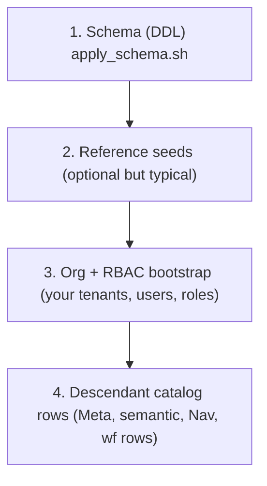

# Database population (adopter guide)

This page describes **how data gets into PostgreSQL** for GoliathApp deployments: **schema installation**, **reference / platform seeds**, **organization and RBAC bootstrap**, and **descendant-owned registration** (Meta classes, semantic registry, NavTree, actions). It complements [schema-apply.md](schema-apply.md) (ordered DDL) and the architecture guides ([architecture.md](architecture.md), [adopter-guide.md](adopter-guide.md)).

**Boundary (non‑negotiable):** **Workers and device adapters do not connect to PostgreSQL.** They use **`goliath-gateway`** HTTP only (`contracts/openapi.yaml`). **Operational seeding** is done by **authorized operators** with `psql` or migration jobs using **privileged** database roles — never with worker credentials.

A **product-specific companion** (for example a science stack that shares types with this platform) should link here for **generic** apply/seed order and keep domain recipes in its own repository.

## Layers of population

Think of four layers. Order matters; skipping a lower layer leaves upper layers empty or broken.



| Layer | What it is | Source of truth | Typical actors |
|-------|------------|-----------------|----------------|
| **1. Schema** | Tables, functions, procedures, types, gateway roles | `workflow_engine/sql_pg/apply_schema.sh` → ordered `SCRIPTS` ([schema-apply.md](schema-apply.md)) | DBA / infra CI |
| **2. Platform/reference seeds** | Core semantic registry rows, catalog `ActionSpec` rows in `wf`, **baseline administrative NavTree** | `python3 workflow_engine/sql_pg/seed_semantic_catalog.py`, `python3 workflow_engine/sql_pg/seed_action_catalog.py --use-db`, `psql … -f workflow_engine/sql_pg/seed_platform_nav_tree.sql` | Release automation |
| **3. Org + RBAC** | Organizations, users, roles, scopes, navigation entitlements | `portal.sp_organization_*`, `portal.sp_*` RBAC procedures ([rbac.md](rbac.md)) | Tenant admin / bootstrap job |
| **4. Descendant extension** | Domain namespaces, semantic entities/requests, NavTree nodes, workflows, Meta classes | Your SQL + Python catalogs (`goliath.action_catalogs`, etc.) | Application team |

**Mandatory vs optional (precise):**

| Item | Required for | Seeded / authored by |
|------|----------------|----------------------|
| **`apply_schema.sh`** (DDL) | Any PostgreSQL surface in this repo | Platform release / DBA |
| **`seed_action_catalog.py --use-db`** | **Any** workflow graph whose nodes reference **`action_name`** values (including engine actions such as `workflow.const_string`) — `wf_repo_create_workflow_graph` fails on unknown names | Platform release automation (`goliath.action_catalogs` in `workflow_engine/pyproject.toml` → `goliath_app/actions/registry.py`) |
| **`seed_semantic_catalog.py`** | Portal semantic registry as shipped; not required to create `wf.*` graphs alone | Platform release automation |
| **`seed_platform_nav_tree.sql`** | **Inherited platform operator menu** (`portal."NavTree"` under `/app`, `organization_admin` Role2Node + Role_Permissions); empty databases stay at NavTree count 0 without it | Platform release automation (after catalog seeds; re-run after new org scopes) |
| **Org + RBAC** (`portal.sp_organization_*`, sessions, roles) | **Interactive portal** and RBAC-gated operations | Tenant admin / bootstrap |
| **`portal.semantic_*` + `Meta.*`** | Semantic UI, Meta validation, typed catalogs that tie to portal | Platform seeds + **descendant** registrations |
| **`wf.workflow_*` graph rows** | Runnable workflow instances | **Product** (SQL, `portal.sp_create_workflow_graph`, gateway, or `ops` deploy tools — not DDL) |
| **`cfg.domain_program`** | **Storing** a DomainProgram JSON document and optional links to a compiled graph | **Product** (see `cfg_registry_tables.sql`, FKs in `cfg_wf_relationships.sql`) |
| **`wf.worker` / `wf.worker_token` / sessions** | **Claiming** READY tasks via `wf.sp_worker_request_task` (gateway path in production) | Enrollment / ops (see [workers.md](workers.md)) |

**Runtime gap (do not paper over):** `wf.wf_build_input_json_for_action` in `03_engine_core.sql` returns only `workflow_input_template` merged to JSON. **`05_runtime_parity.sql` replaces** that function with placeholder resolution and `workflow_input_binding` merge ([workflow-engine.md](workflow-engine.md) describes the richer path). **Python in-process execution** uses a different input build (`workflow_engine/local/`). Treat **hand-written template JSON** as the **portable** contract unless you rely on the parity overload and binding tables.

## Execution model: `psql` with `ON_ERROR_STOP`

The platform’s own apply script runs every file with **`psql -v ON_ERROR_STOP=1 -f …`** ([`apply_schema.sh`](https://github.com/Goliath-Research/GoliathApp/blob/main/workflow_engine/sql_pg/apply_schema.sh)). That stops the transaction **on the first error** — failures do **not** silently continue.

- **Secret references:** pass passwords via **`PGPASSWORD`**, **`PGPASSFILE`**, or a **URL** you construct in CI — never commit secrets.
- **Reruns:** The `sql_pg` tree is written for **repeatable apply** on an existing database (`CREATE IF NOT EXISTS`, `CREATE OR REPLACE`, selective drops before incompatible changes) ([schema-apply.md](schema-apply.md)).
- **No release ledger:** One invocation applies the **entire** `SCRIPTS` list; there is **no** per-file “already applied” table in the shell script.
- **Post-apply contract:** When `python3` is available, `validate_contract.py` checks that required objects exist.

### Example: disposable local database (operator)

The following is a **pattern** for a throwaway instance. Adjust host, database name, and roles for your environment.

```bash
export PGHOST=localhost
export PGPORT=5432
export PGDATABASE=goliath_docs_test
export PGUSER=postgres
export PGSSLMODE=prefer
# export PGPASSWORD='…'   # set in your shell or CI secret store, never in repo

psql -v ON_ERROR_STOP=1 -c "SELECT current_user, version();"
bash workflow_engine/sql_pg/apply_schema.sh
```

**Compatibility:** Scripts target **PostgreSQL 15+**; **17+** is recommended where noted ([schema-apply.md](schema-apply.md)). Hosted providers (including **Neon**) must expose a compatible server and TLS; use `sslmode` appropriate to your policy (`require` / `verify-full`).

## Platform seeds (Python, not raw SQL)

After DDL apply, run the **shipped seed scripts** from a machine that can import `goliath_app` (install with `pip install -e "workflow_engine/[dev]"` or equivalent):

```bash
export PGHOST=… PGPORT=5432 PGDATABASE=… PGUSER=…
export PGPASSWORD=…   # or PGPASSFILE

python3 workflow_engine/sql_pg/seed_semantic_catalog.py
python3 workflow_engine/sql_pg/seed_action_catalog.py --use-db
psql -v ON_ERROR_STOP=1 -f workflow_engine/sql_pg/seed_platform_nav_tree.sql
```

**Important:** `seed_action_catalog.py` **defaults to dry-run** — it only prints action names unless you pass **`--use-db`** ([`seed_action_catalog.py`](https://github.com/Goliath-Research/GoliathApp/blob/main/workflow_engine/sql_pg/seed_action_catalog.py)). `seed_semantic_catalog.py` always writes when `PGHOST` is set.

These scripts call **`portal.sp_semantic_register_*`** and **`wf.wf_repo_upsert_*`** procedures implemented in `workflow_engine/sql_pg/`.

### Baseline NavTree (SQL platform seed)

GoliathApp ships the **inherited administrative menu** in [`seed_platform_nav_tree.sql`](https://github.com/Goliath-Research/GoliathApp/blob/main/workflow_engine/sql_pg/seed_platform_nav_tree.sql). It is **not** DDL and **not** a one-off migration: every empty GoliathApp database that has completed `apply_schema.sh` and the Python catalog seeds should run this script so operators see platform administration, Meta/OOP surfaces, workflows, semantic layer, configuration, operations, views, and optional `inv` — not an empty NavTree.

- **Registration:** `portal.sp_nav_register_node` (with `smallint` `p_seq`), `portal."NodeInfos"."FrameKey"` bound to platform-host routes under `/app/…` (screens may be P3–P5; nodes are still registered).
- **RBAC:** `organization_admin` receives `Role_Permissions` for Meta and platform operator permissions, and `portal.sp_grant_role_nav_node` for each active **organization** scope.
- **Descendants** add domain nodes on top ([nav-tree-meta.md](nav-tree-meta.md)); they do not replace this seed.
- **Re-run:** idempotent. Run again after `portal.sp_organization_create` if the first run happened before any organization scope existed (Role2Node grants are per scope).

## Database roles (least privilege)

`database_gateway_roles.sql` (end of apply) defines **`goliath_portal`** and **`goliath_gateway`** logins with **execute-only** surfaces: portal callers use **`portal.sp_*`**; workers use **`wf.sp_*`** via the gateway process — **not** via direct SQL on fleet hosts ([`database_gateway_roles.sql`](https://github.com/Goliath-Research/GoliathApp/blob/main/workflow_engine/sql_pg/database_gateway_roles.sql), [rbac.md](rbac.md)).

- **Bootstrap / migrations** typically run as **`postgres`** or a dedicated owner role with **`CREATE`** on schemas.
- **Semantic registration internals** (`portal.sp_semantic_register_*`) are **`REVOKE`**d from `goliath_portal`; registration belongs to **release automation**, not end users ([rbac.md](rbac.md)).

## Entity and dependency inventory (from code — no invented names)

The following lists **tables and procedures actually referenced** when persisting and running workflows. Names are taken from `workflow_engine/sql_pg/*.sql`, `workflow_engine/contract/workflow_definition_spec.py`, and `workflow_engine/rest/db/postgres.py`.

### DomainProgram (source) vs compiled graph (database)

| Stage | Where it lives | Contract / code |
|-------|----------------|-------------------|
| **Authoring JSON** | Files or `cfg.domain_program.document_json` | `workflow_engine/domain/program.py` (`DomainProgram` — `programVersion`, `name`, `variables`, `body`, …) |
| **Compiled graph spec** | JSON matching `WorkflowDefinitionSpec` | `workflow_engine/contract/workflow_definition_spec.py` |
| **Insert graph** | `wf.workflow_def`, `wf.workflow_version`, `wf.workflow_node`, `wf.workflow_edge`, optional `wf.workflow_input_template`, bindings, `wf.workflow_collection_binding`, `wf.event_subscription` | `wf.wf_repo_create_workflow_graph` (`wf_repo_create_workflow_graph.sql`, JSON field **`action_name`** on ACTION nodes); portal wrapper `portal.sp_create_workflow_graph` (`portal_workflow_api.sql`) optionally checks **`nodes[].action`** (not `action_name` — if you rely on portal pre-checks, align with that key or call `wf.wf_repo_create_workflow_graph` directly) |
| **Link document → graph (optional)** | `cfg.domain_program.workflow_def_id`, `cfg.domain_program.compiled_workflow_version_id` | `cfg_registry_tables.sql`, FKs `fk_cfg_dp_workflow_def` / `fk_cfg_dp_compiled_version` in `cfg_wf_relationships.sql` |
| **Start instance** | `wf.workflow_instance`, `wf.node_execution`, … | `wf.wf_repo_create_workflow_instance` + `wf.sp_start_workflow_instance` (`02_repository_api.sql`, `01_worker_api.sql`) → `wf.wf_engine_activate` (`03_engine_core.sql`) |

**Child extension contract (DomainProgram → DB):** Ship **`ActionSpec`** rows through **`goliath.action_catalogs`** so `seed_action_catalog.py --use-db` (or your migration calling `wf.wf_repo_upsert_semantic_action` / schemas / `wf.wf_repo_bind_action_data_types`) registers **`wf.workflow_action`** names your program uses. Compile with **`compile_domain_program_file`** (`workflow_engine/domain/compiler.py`) or your pipeline, then persist with **`wf_repo_create_workflow_graph`** (or `portal.sp_create_workflow_graph`). Optionally store the source JSON and set **`cfg.domain_program`** FKs to the created definition/version.

### Typed actions and handlers (registration)

- **DB:** `wf.workflow_action`, `wf.workflow_action_schema`; optional `wf.data_type` + `wf.wf_repo_bind_action_data_types` for catalog typing (`seed_action_catalog.py`).
- **Python catalog:** `goliath_app/actions/spec.py` (`ActionSpec`), merged by `goliath_app/actions/registry.py` from entry points declared in `workflow_engine/pyproject.toml`.

### Workflow graph tables (required shape)

`wf_repo_create_workflow_graph` **requires** `name`, `root_node_key`, and `nodes` (see `workflow_engine/sql_pg/wf_repo_create_workflow_graph.sql`). Each **ACTION** node may set **`action_name`**; that name **must** exist in `wf.workflow_action`. **Optional** JSON arrays in the same spec: `edges`, `input_bindings`, `output_bindings`, `scope_defaults`, `collection_bindings`, `event_triggers`, `variable_schemas` — each maps to the tables named in that function.

### Schedules, subscriptions, capabilities

| Mechanism | Persistence | Code / SQL |
|-----------|-------------|------------|
| **Event-driven start / wait** | `wf.event_subscription`, `wf.event_type` | `event_triggers` in `WorkflowDefinitionSpec` → `wf.wf_ensure_event_type` inside `wf_repo_create_workflow_graph.sql`; delivery in `wf_event_plane.sql` |
| **SCHEDULE nodes** | `wf.workflow_node` (`node_type = 'SCHEDULE'`, `schedule_interval_seconds`) | Allowed node types in `wf_repo_create_workflow_graph.sql`; continuation `wf_schedule_support.sql` |
| **Worker capability filter** | `wf.workflow_action.capability`, `wf.worker.capabilities` JSON array | Claim query `wf.sp_worker_request_task` (`01_worker_api.sql`); dispatch columns documented in [workflow-engine.md](workflow-engine.md) |

### Semantic / Meta / org / nav (portal — product-specific)

- **Semantic:** `portal.semantic_namespace`, `portal.semantic_entity`, attributes, requests — procedures `portal.sp_semantic_register_*` (`portal_semantic_api.sql`). Requests need generated **composite types** in schema **`portal`** ([semantic-extensions.md](semantic-extensions.md)).
- **Meta:** class/object APIs under **`"Meta"`** schema ([meta-model.md](meta-model.md)); optional bridge to `wf.data_type` / semantic entities.
- **Nav (baseline):** `seed_platform_nav_tree.sql` — platform-owned tree under `/app` ([nav-tree-meta.md](nav-tree-meta.md)).
- **Nav (descendant):** `portal.sp_nav_register_node` (Meta `portal/NavNode` + legacy `portal."NavTree"` row); **Role2Node** grants are separate RBAC steps.
- **Org / scope:** organization and scope procedures as in [rbac.md](rbac.md) — **not** implied by `wf_repo_create_workflow_graph` alone.

### Disposable DB: minimal runnable + claimable configuration

[`docs_bootstrap_minimal_workflow.sql`](https://github.com/Goliath-Research/GoliathApp/blob/main/workflow_engine/sql_pg/examples/docs_bootstrap_minimal_workflow.sql) (not in `apply_schema.sh`) runs after **`apply_schema.sh`** + **`seed_action_catalog.py --use-db`**. It builds a **SEQUENCE → ACTION** graph using engine action **`workflow.const_string`**, inserts **`cfg.domain_program`** with FKs to `wf.workflow_def` / `wf.workflow_version`, starts an instance, and leaves a **READY** `node_execution` row claimable by a worker whose **`wf.worker.capabilities`** include **`workflow.compute`** (seeded for that action). Re-runs **clear `cfg.domain_program` FKs**, delete **`wf.loop_state`** and **`wf.workflow_instance`** rows for that definition, **delete `wf.workflow_edge`** rows (edges do not cascade when versions are removed), then call **`wf.sp_delete_workflow_def`** with **`p_delete_instances := false`** — **`wf.sp_delete_workflow_def` alone is not sufficient** on graphs with edges because it deletes versions before nodes. It does **not** start pods or workers.

## Descendant registration (neutral example)

Descendant applications **add rows** through the same **registration APIs** the platform uses:

| Concern | API (examples) | Notes |
|---------|------------------|-------|
| **Semantic namespace** | `INSERT … portal.semantic_namespace` or first `CALL portal.sp_semantic_register_entity` (auto-inserts namespace) | Core namespaces `core` and `engine` are inserted in `portal_semantic_schema.sql` |
| **Semantic entity + attributes + requests** | `CALL portal.sp_semantic_register_entity`, `CALL portal.sp_semantic_register_attribute`, `CALL portal.sp_semantic_register_request` | Request registration requires **composite row types** in schema **`portal`** (generated by `goliath-semantic-export`) — see [semantic-extensions.md](semantic-extensions.md) |
| **NavTree (domain)** | `SELECT portal.sp_nav_register_node(…)` | Cast `p_seq` to `smallint` so PostgreSQL picks the correct function overload (`workflow_engine/sql_pg/portal_shell_schema.sql`). Do **not** re-seed the baseline `/app` tree — use `seed_platform_nav_tree.sql` on platform upgrades. |
| **RBAC navigation grants** | `portal.sp_grant_role_nav_node`, `portal.sp_deny_role_nav_node` | See [rbac.md](rbac.md) |
| **Actions** | `CALL wf.wf_repo_upsert_workflow_action` (wide overload after dispatch scripts), `wf.wf_repo_upsert_data_type`, `wf.wf_repo_bind_action_data_types` | Prefer authoring **`ActionSpec`** in Python and `seed_action_catalog.py --use-db` or your own caller — see [actions.md](actions.md) |
| **Meta classes / objects** | `"Meta".sp_meta_publish_class_type`, `"Meta".sp_obj_insert`, etc. | See [meta-model.md](meta-model.md) |

### Checked-in neutral SQL sample

[`descendant_acme_child_register_demo.sql`](https://github.com/Goliath-Research/GoliathApp/blob/main/workflow_engine/sql_pg/examples/descendant_acme_child_register_demo.sql) shows a **synthetic** `acme_child` semantic namespace, entity, attributes, and a NavTree node. It **does not** copy platform seed scripts; it **depends** on procedures installed by `apply_schema.sh`.

**Do not** point `storage_relation` at tables that do not exist — create app-owned tables/views in **your** migration first.

## Verification queries (examples, not fabricated results)

After seeding, use **read-only** checks (as a privileged role):

```sql
-- Semantic namespaces and entity count
SELECT code, display_name FROM portal.semantic_namespace ORDER BY code;
SELECT namespace, count(*) FROM portal.semantic_entity GROUP BY namespace ORDER BY 1;

-- Workflow actions present
SELECT count(*) FROM wf.workflow_action;

-- NavTree sample
SELECT "ID", "Caption", "NodePath" FROM portal."NavTree" ORDER BY "Seq" LIMIT 20;
```

Expect **zero** `wf.workflow_action` rows until **`seed_action_catalog.py --use-db`** (or your own upserts) have run.

## Operational vs demo data

| Data class | Safe on production | Typical handling |
|-----------|--------------------|------------------|
| **DDL + gateway roles** | Yes | CI-reviewed `apply_schema.sh` |
| **Platform semantic + action seeds** | Yes | Idempotent scripts |
| **Demo fixtures** | No (unless isolated env) | Separate database or disposable branch |
| **Worker fleet credentials** | N/A (not SQL) | Enrollment via gateway ([workers.md](workers.md)) |

## Troubleshooting and rollback

- **Failed mid-apply:** PostgreSQL runs each `psql -f` file in its own implicit transaction unless the file wraps explicit `BEGIN`/`COMMIT`. Treat the database as **unknown** until you inspect partial objects; restore from **backup** for production ([schema-apply.md](schema-apply.md) discusses replace/drop patterns).
- **Neon / hosted branching:** Use provider **branch** or **snapshot restore** for disposable testing; keep **TLS** and **pooler** settings aligned with libpq (`sslmode`).
- **Version skew:** Applying an older `sql_pg` tree against a database that already ran newer phases can fail (`CREATE OR REPLACE` limitations on `RETURNS TABLE` row-type changes — [schema-apply.md](schema-apply.md)).

## Known limitations

- **`seed_action_catalog.py`** without `--use-db` does **not** write rows — easy to mistake for success.
- **Semantic requests** need **generated `portal` row types**; ad‑hoc `CALL portal.sp_semantic_register_request` without those types will raise — follow `goliath-semantic-export` ([semantic-extensions.md](semantic-extensions.md)).
- **Workflow graph rows** (`wf.workflow_def`, instances) are **not** created by `apply_schema.sh`; persist via **`wf.wf_repo_create_workflow_graph`**, **`portal.sp_create_workflow_graph`**, **`goliath-cfg`**, or product writers — see [workflow-engine.md](workflow-engine.md).
- **`deploy_test_bed.sh`** stops when expected seed files are **missing** from this repository ([workflow-engine.md](workflow-engine.md) §Test bed script).

## Evidence (local disposable PostgreSQL 16)

On a **throwaway** database used only to validate documentation, this repository’s `apply_schema.sh` completed successfully and `SELECT count(*) FROM wf.workflow_action` returned **0** until `seed_action_catalog.py --use-db` was run (then **14** rows). **`descendant_acme_child_register_demo.sql`** completed and produced `portal.semantic_entity` id **7** for `acme_child.demo_part` with NavTree caption **AcmeChild Demo**. **`docs_bootstrap_minimal_workflow.sql`** produced `wf.workflow_def` / `cfg.domain_program` name **`docs_bootstrap_const_echo`**, a **RUNNING** instance, and a **READY** `node_execution` for **`workflow.const_string`**. These numbers are **environment-specific** — use them as examples of *what to query*, not as guarantees.

## See also

- [schema-apply.md](schema-apply.md) — authoritative script order and rerun semantics  
- [inventory-module.md](inventory-module.md) — optional `inv` enablement steps  
- [semantic-extensions.md](semantic-extensions.md) — namespaces and registration procedures  
- [actions.md](actions.md) — `wf.workflow_action` and data types  
