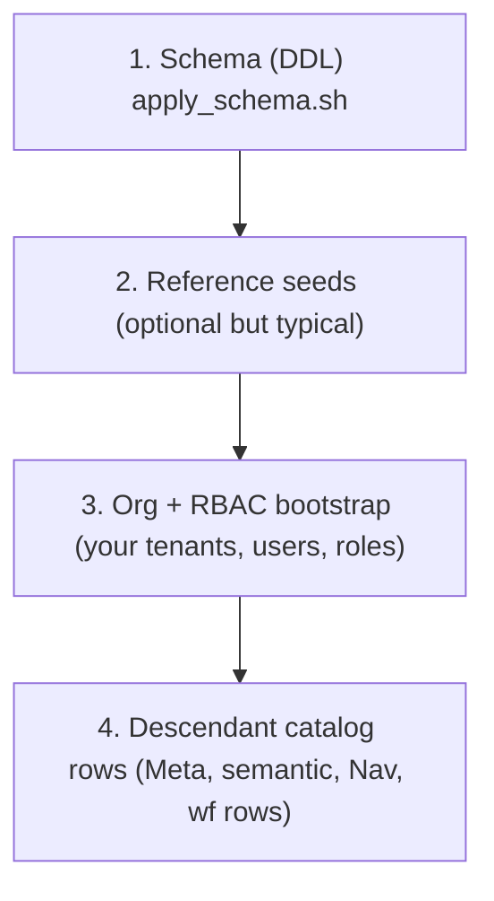

# Database population (adopter guide)

This page describes **how data gets into PostgreSQL** for GoliathApp deployments: **schema installation**, **reference / platform seeds**, **organization and RBAC bootstrap**, and **descendant-owned registration** (Meta classes, semantic registry, NavTree, actions). It complements [schema-apply.md](schema-apply.md) (ordered DDL) and the architecture guides ([architecture.md](architecture.md), [adopter-guide.md](adopter-guide.md)).

**Boundary (non‑negotiable):** **Workers and device adapters do not connect to PostgreSQL.** They use **`goliath-gateway`** HTTP only (`contracts/openapi.yaml`). **Operational seeding** is done by **authorized operators** with `psql` or migration jobs using **privileged** database roles — never with worker credentials.

A **product-specific companion** (for example a science stack that shares types with this platform) should link here for **generic** apply/seed order and keep domain recipes in its own repository.

## Layers of population

Think of four layers. Order matters; skipping a lower layer leaves upper layers empty or broken.



| Layer | What it is | Source of truth | Typical actors |
|-------|------------|-----------------|----------------|
| **1. Schema** | Tables, functions, procedures, types, gateway roles | `workflow_engine/sql_pg/apply_schema.sh` → ordered `SCRIPTS` ([schema-apply.md](schema-apply.md)) | DBA / infra CI |
| **2. Platform/reference seeds** | Core semantic registry rows, catalog `ActionSpec` rows in `wf` | `python3 workflow_engine/sql_pg/seed_semantic_catalog.py`, `python3 workflow_engine/sql_pg/seed_action_catalog.py --use-db` | Release automation |
| **3. Org + RBAC** | Organizations, users, roles, scopes, navigation entitlements | `portal.sp_organization_*`, `portal.sp_*` RBAC procedures ([rbac.md](rbac.md)) | Tenant admin / bootstrap job |
| **4. Descendant extension** | Domain namespaces, semantic entities/requests, NavTree nodes, workflows, Meta classes | Your SQL + Python catalogs (`goliath.action_catalogs`, etc.) | Application team |

**Mandatory vs optional:** The **schema** layer is **mandatory** for a working engine. **Semantic** and **action** seeds are **required for a functioning portal semantic layer and default platform actions** in most deployments; the scripts are idempotent and safe to re-run. **Org/RBAC** and **descendant data** are **environment-specific**.

## Execution model: `psql` with `ON_ERROR_STOP`

The platform’s own apply script runs every file with **`psql -v ON_ERROR_STOP=1 -f …`** ([`apply_schema.sh`](https://github.com/Goliath-Research/GoliathApp/blob/main/workflow_engine/sql_pg/apply_schema.sh)). That stops the transaction **on the first error** — failures do **not** silently continue.

- **Secret references:** pass passwords via **`PGPASSWORD`**, **`PGPASSFILE`**, or a **URL** you construct in CI — never commit secrets.
- **Reruns:** The `sql_pg` tree is written for **repeatable apply** on an existing database (`CREATE IF NOT EXISTS`, `CREATE OR REPLACE`, selective drops before incompatible changes) ([schema-apply.md](schema-apply.md)).
- **No release ledger:** One invocation applies the **entire** `SCRIPTS` list; there is **no** per-file “already applied” table in the shell script.
- **Post-apply contract:** When `python3` is available, `validate_contract.py` checks that required objects exist.

### Example: disposable local database (operator)

The following is a **pattern** for a throwaway instance. Adjust host, database name, and roles for your environment.

```bash
export PGHOST=localhost
export PGPORT=5432
export PGDATABASE=goliath_docs_test
export PGUSER=postgres
export PGSSLMODE=prefer
# export PGPASSWORD='…'   # set in your shell or CI secret store, never in repo

psql -v ON_ERROR_STOP=1 -c "SELECT current_user, version();"
bash workflow_engine/sql_pg/apply_schema.sh
```

**Compatibility:** Scripts target **PostgreSQL 15+**; **17+** is recommended where noted ([schema-apply.md](schema-apply.md)). Hosted providers (including **Neon**) must expose a compatible server and TLS; use `sslmode` appropriate to your policy (`require` / `verify-full`).

## Platform seeds (Python, not raw SQL)

After DDL apply, run the **shipped seed scripts** from a machine that can import `goliath_app` (install with `pip install -e "workflow_engine/[dev]"` or equivalent):

```bash
export PGHOST=… PGPORT=5432 PGDATABASE=… PGUSER=…
export PGPASSWORD=…   # or PGPASSFILE

python3 workflow_engine/sql_pg/seed_semantic_catalog.py
python3 workflow_engine/sql_pg/seed_action_catalog.py --use-db
```

**Important:** `seed_action_catalog.py` **defaults to dry-run** — it only prints action names unless you pass **`--use-db`** ([`seed_action_catalog.py`](https://github.com/Goliath-Research/GoliathApp/blob/main/workflow_engine/sql_pg/seed_action_catalog.py)). `seed_semantic_catalog.py` always writes when `PGHOST` is set.

These scripts call **`portal.sp_semantic_register_*`** and **`wf.wf_repo_upsert_*`** procedures implemented in `workflow_engine/sql_pg/`.

## Database roles (least privilege)

`database_gateway_roles.sql` (end of apply) defines **`goliath_portal`** and **`goliath_gateway`** logins with **execute-only** surfaces: portal callers use **`portal.sp_*`**; workers use **`wf.sp_*`** via the gateway process — **not** via direct SQL on fleet hosts ([`database_gateway_roles.sql`](https://github.com/Goliath-Research/GoliathApp/blob/main/workflow_engine/sql_pg/database_gateway_roles.sql), [rbac.md](rbac.md)).

- **Bootstrap / migrations** typically run as **`postgres`** or a dedicated owner role with **`CREATE`** on schemas.
- **Semantic registration internals** (`portal.sp_semantic_register_*`) are **`REVOKE`**d from `goliath_portal`; registration belongs to **release automation**, not end users ([rbac.md](rbac.md)).

## Descendant registration (neutral example)

Descendant applications **add rows** through the same **registration APIs** the platform uses:

| Concern | API (examples) | Notes |
|---------|------------------|-------|
| **Semantic namespace** | `INSERT … portal.semantic_namespace` or first `CALL portal.sp_semantic_register_entity` (auto-inserts namespace) | Core namespaces `core` and `engine` are inserted in `portal_semantic_schema.sql` |
| **Semantic entity + attributes + requests** | `CALL portal.sp_semantic_register_entity`, `CALL portal.sp_semantic_register_attribute`, `CALL portal.sp_semantic_register_request` | Request registration requires **composite row types** in schema **`portal`** (generated by `goliath-semantic-export`) — see [semantic-extensions.md](semantic-extensions.md) |
| **NavTree** | `SELECT portal.sp_nav_register_node(…)` | Cast `p_seq` to `smallint` so PostgreSQL picks the correct function overload (`workflow_engine/sql_pg/portal_shell_schema.sql`) |
| **RBAC navigation grants** | `portal.sp_grant_role_nav_node`, `portal.sp_deny_role_nav_node` | See [rbac.md](rbac.md) |
| **Actions** | `CALL wf.wf_repo_upsert_workflow_action` (wide overload after dispatch scripts), `wf.wf_repo_upsert_data_type`, `wf.wf_repo_bind_action_data_types` | Prefer authoring **`ActionSpec`** in Python and `seed_action_catalog.py --use-db` or your own caller — see [actions.md](actions.md) |
| **Meta classes / objects** | `"Meta".sp_meta_publish_class_type`, `"Meta".sp_obj_insert`, etc. | See [meta-model.md](meta-model.md) |

### Checked-in neutral SQL sample

[`descendant_acme_child_register_demo.sql`](https://github.com/Goliath-Research/GoliathApp/blob/main/workflow_engine/sql_pg/examples/descendant_acme_child_register_demo.sql) shows a **synthetic** `acme_child` semantic namespace, entity, attributes, and a NavTree node. It **does not** copy platform seed scripts; it **depends** on procedures installed by `apply_schema.sh`.

**Do not** point `storage_relation` at tables that do not exist — create app-owned tables/views in **your** migration first.

## Verification queries (examples, not fabricated results)

After seeding, use **read-only** checks (as a privileged role):

```sql
-- Semantic namespaces and entity count
SELECT code, display_name FROM portal.semantic_namespace ORDER BY code;
SELECT namespace, count(*) FROM portal.semantic_entity GROUP BY namespace ORDER BY 1;

-- Workflow actions present
SELECT count(*) FROM wf.workflow_action;

-- NavTree sample
SELECT "ID", "Caption", "NodePath" FROM portal."NavTree" ORDER BY "Seq" LIMIT 20;
```

Expect **zero** `wf.workflow_action` rows until **`seed_action_catalog.py --use-db`** (or your own upserts) have run.

## Operational vs demo data

| Data class | Safe on production | Typical handling |
|-----------|--------------------|------------------|
| **DDL + gateway roles** | Yes | CI-reviewed `apply_schema.sh` |
| **Platform semantic + action seeds** | Yes | Idempotent scripts |
| **Demo fixtures** | No (unless isolated env) | Separate database or disposable branch |
| **Worker fleet credentials** | N/A (not SQL) | Enrollment via gateway ([workers.md](workers.md)) |

## Troubleshooting and rollback

- **Failed mid-apply:** PostgreSQL runs each `psql -f` file in its own implicit transaction unless the file wraps explicit `BEGIN`/`COMMIT`. Treat the database as **unknown** until you inspect partial objects; restore from **backup** for production ([schema-apply.md](schema-apply.md) discusses replace/drop patterns).
- **Neon / hosted branching:** Use provider **branch** or **snapshot restore** for disposable testing; keep **TLS** and **pooler** settings aligned with libpq (`sslmode`).
- **Version skew:** Applying an older `sql_pg` tree against a database that already ran newer phases can fail (`CREATE OR REPLACE` limitations on `RETURNS TABLE` row-type changes — [schema-apply.md](schema-apply.md)).

## Known limitations

- **`seed_action_catalog.py`** without `--use-db` does **not** write rows — easy to mistake for success.
- **Semantic requests** need **generated `portal` row types**; ad‑hoc `CALL portal.sp_semantic_register_request` without those types will raise — follow `goliath-semantic-export` ([semantic-extensions.md](semantic-extensions.md)).
- **Workflow graph rows** (`wf.workflow_definition`, instances) are not created by `apply_schema.sh`; use **`goliath-cfg`**, portal APIs, or your product’s writer — see [workflow-engine.md](workflow-engine.md).

## Evidence (local disposable PostgreSQL 16)

On a **throwaway** database used only to validate documentation, this repository’s `apply_schema.sh` completed successfully and `SELECT count(*) FROM wf.workflow_action` returned **0** until `seed_action_catalog.py --use-db` was run (then **14** rows). **`descendant_acme_child_register_demo.sql`** completed and produced `portal.semantic_entity` id **7** for `acme_child.demo_part` with NavTree caption **AcmeChild Demo**. These numbers are **environment-specific** — use them as examples of *what to query*, not as guarantees.

## See also

- [schema-apply.md](schema-apply.md) — authoritative script order and rerun semantics  
- [inventory-module.md](inventory-module.md) — optional `inv` enablement steps  
- [semantic-extensions.md](semantic-extensions.md) — namespaces and registration procedures  
- [actions.md](actions.md) — `wf.workflow_action` and data types  
