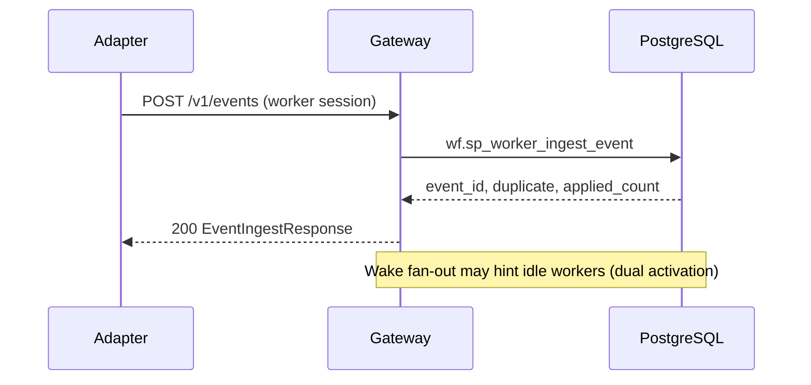
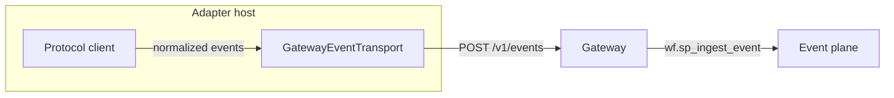

# Device adapters (gateway-only)

Device and protocol adapters run on enrolled worker hosts. They **never** open Postgres or hold `LISTEN` / wake DSNs. All persistence goes through **`goliath-gateway`**: `POST /v1/events` (**worker session** or **API key** — see below), optional `POST /v1/workers/wakes/wait`, and `POST /v1/workers/tasks/request` for capability-scoped work.

## Boundaries

- **App (`goliath_app`)** provides versioned hooks (`DeviceAdapterBase`), normalized event shapes, secret references, and reference MQTT / Home Assistant adapters. It does **not** import extension apps (for example domain-specific pipelines).
- **Trust model**: adapter configuration (organization labels, broker URLs, allowlists) is resolved on the host via **secret refs** and environment — **not** from unauthenticated protocol payloads.
- **Actuation**: default is **fail closed**. MQTT broker `PUBACK` and Home Assistant service-call success are **transport acknowledgements**, not confirmation that a physical actuator moved. Child apps must add explicit safety and idempotency policy.
- **Generic command path**: workflows use platform actions `workflow.device_adapter.command` and `workflow.device_adapter.observe` (see `goliath_app.engine.catalog`). App-side handler `goliath_app.device_adapter.command_handler` is **default deny**; set `GOLIATH_ADAPTER_COMMAND_SAFETY=module:hook` for domain allowlists. `DeviceAdapterCommandOutput.ack_kind` distinguishes **`protocol_accepted`** (transport) from **`physical_pending`** / **`physical_confirmed`** — never treat one as the other.

## Extension pattern

Child repositories subclass `DeviceAdapterBase`, register capabilities, implement `translate_to_events`, and optionally override `safety_gate_command`. The neutral example below uses a synthetic “bench” device:

```python
from goliath_app.device_adapter.base import DeviceAdapterBase, DeviceAdapterConfig
from goliath_app.device_adapter.contract import DeviceNormalizedEvent


class BenchAdapterConfig(DeviceAdapterConfig):
    pass


class BenchTelemetryAdapter(DeviceAdapterBase):
    def normalized_event_sources(self):
        return (f"bench:{self.config.adapter_id}",)

    def translate_to_events(self, raw_message):
        return (
            DeviceNormalizedEvent(
                event_type="device.bench.reading.v1",
                payload={
                    "organization_key": self.config.organization_key,
                    "device_key": self.config.device_key,
                    "sample_value": raw_message.get("v"),
                },
            ),
        )
```

## Event ingest (authorization, not “auth = ok”)

Worker authentication alone is **not** authorization. The database enforces:

1. **Worker path** — `wf.sp_worker_ingest_event`: `wf.wf_worker_authenticate` then `wf.wf_authorize_worker_event_ingest`, which requires `device.adapter.ingest` in `wf.worker.capabilities` (unless omnibus `*`) and a non-null `wf.worker.event_ingest_binding` (`source`, `org_key`, optional `device_id`, `event_types`) matching the request.
2. **API key path** — header `X-Goliath-Event-Ingest-Key`: gateway hashes the key and calls `wf.sp_ingest_event_with_api_key`, which checks `wf.event_ingest_api_key` (allowed orgs/sources/event types). `payload.organization_key` is **required** and must match the key row.
3. **Gateway overlay** — for worker ingest, the gateway merges binding `organization_key` / `device_key` into `payload` when set; if the client sends a different value, the request is **403** (anti-spoof).

**Backward compatibility:** Callers that previously posted to `/v1/events` with only a worker session must add **`device.adapter.ingest`** plus a server-side **`event_ingest_binding`**. Portal/BFF callers should migrate to **`X-Goliath-Event-Ingest-Key`** with a row in `wf.event_ingest_api_key` (hashed at rest). Either path still runs `wf.sp_ingest_event` after authorization.



## Periodic reporting

Inherited periodic work uses a **`SCHEDULE`** composite node in the workflow graph (child `ACTION`, e.g. `workflow.device_adapter.observe`) with `schedule_interval_seconds`. When the child completes, the engine re-enqueues the next run with `available_at_utc = now + interval` — **one** schedule controller, no second host-level cron for that graph. `wf.sp_worker_request_task` advances the `SCHEDULE` composite when a tick finishes so the next READY action is visible. Adapters may still emit optional **heartbeat** events via `run_adapter_process` for process liveness only; heartbeats do **not** replace workflow-owned periodic **claims**.



## Reference adapters

| Adapter | Module / CLI | Dependencies (optional extra) |
|--------|----------------|------------------------------|
| MQTT | `goliath_app.device_adapter.mqtt_adapter` / `goliath-mqtt-adapter` | `paho-mqtt` |
| Home Assistant | `goliath_app.device_adapter.ha_adapter` / `goliath-ha-adapter` | `websocket-client` |

Install:

`pip install -e "workflow_engine/[dev,device_adapters]"`

### MQTT (Mosquitto)

1. Run a local broker (for example Mosquitto on `127.0.0.1:1883` with TLS off in lab).
2. Set JSON config in `GOLIATH_MQTT_ADAPTER_CONFIG` (password via `password_ref`: `{"env_name": "MQTT_PASSWORD"}` — never commit secrets).
3. Provide `GOLIATH_ADAPTER_WORKER_ID`, `GOLIATH_ADAPTER_WORKER_TOKEN`, and `GOLIATH_ADAPTER_OPEN_SESSION=1`.
4. Run `goliath-mqtt-adapter`.

### Home Assistant

1. Long-lived **access token** in a secret file or env (`token_ref` on config).
2. `entity_allowlist` must be **non-empty** to emit `state_changed` events (fail closed when empty).
3. Run `goliath-ha-adapter` with `GOLIATH_HA_ADAPTER_CONFIG` JSON.

## Extension-app follow-up (separate repository)

To integrate domain sensor storage without coupling this repo:

- **Contracts**: reuse `DeviceNormalizedEvent` / `post_event`; add domain `event_type` strings and `wf.event_subscription` filters in the product’s SQL pack.
- **Workers**: migrate any direct-DB sensor paths to gateway `POST /v1/events` + claim loop; preserve idempotency keys stable per sensor reading source.
- **Allowlists**: map MQTT topics / Home Assistant entities to execution-scope or study keys in product configuration, not in GoliathApp.

## Protocol-level tests

With `GOLIATH_PROTOCOL_TESTS=1` and `workflow_engine/[dev,device_adapters]` installed, `workflow_engine/tests/test_device_adapter_protocol_integration.py` exercises:

- **MQTT**: live broker (CI: `eclipse-mosquitto` service on `localhost:1883`; env `GOLIATH_MQTT_HOST` / `GOLIATH_MQTT_PORT`).
- **Home Assistant**: local mock HTTP + WebSocket server (no real HA Core).

PostgreSQL flows (event subscription → `WAIT_EVENT`, API key ingest, **`SCHEDULE`** → observe claim) live in `workflow_engine/tests/test_device_adapter_inheritance_flow.py` when `POSTGRES_*` points at a migrated database.

## Known gaps

- Gateway does not yet expose a dedicated “adapter enrollment” profile; adapters reuse standard worker enroll + capabilities plus `event_ingest_binding`.
- Optional: first-class gateway route to push commands to an adapter process (today: claimed `workflow.device_adapter.*` in-process handlers / child executors).
