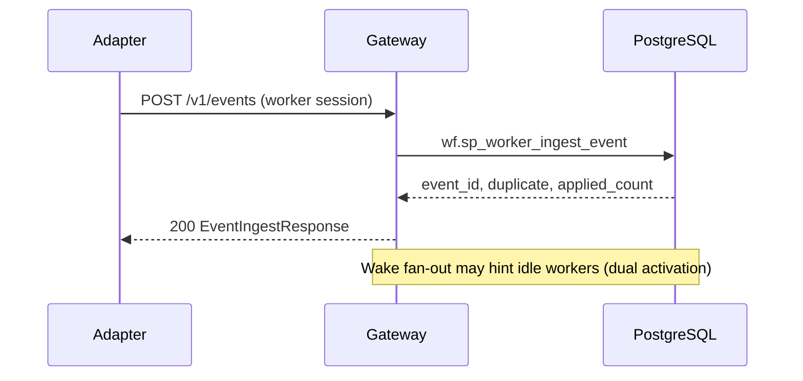
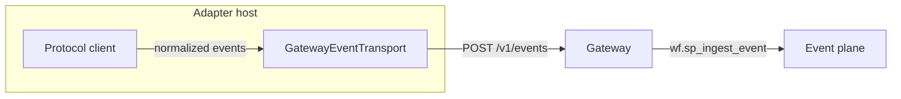

# Device adapters (gateway-only)

Device and protocol adapters run on enrolled worker hosts. They **never** open Postgres or hold `LISTEN` / wake DSNs. All persistence goes through **`goliath-gateway`**: `POST /v1/events` (authenticated like claim), optional `POST /v1/workers/wakes/wait`, and `POST /v1/workers/tasks/request` for capability-scoped work.

## Boundaries

- **App (`goliath_app`)** provides versioned hooks (`DeviceAdapterBase`), normalized event shapes, secret references, and reference MQTT / Home Assistant adapters. It does **not** import extension apps (for example domain-specific pipelines).
- **Trust model**: adapter configuration (organization labels, broker URLs, allowlists) is resolved on the host via **secret refs** and environment — **not** from unauthenticated protocol payloads.
- **Actuation**: default is **fail closed**. MQTT broker `PUBACK` and Home Assistant service-call success are **transport acknowledgements**, not confirmation that a physical actuator moved. Child apps must add explicit safety and idempotency policy.

## Extension pattern

Child repositories subclass `DeviceAdapterBase`, register capabilities, implement `translate_to_events`, and optionally override `safety_gate_command`. The neutral example below uses a synthetic “bench” device:

```python
from goliath_app.device_adapter.base import DeviceAdapterBase, DeviceAdapterConfig
from goliath_app.device_adapter.contract import DeviceNormalizedEvent


class BenchAdapterConfig(DeviceAdapterConfig):
    pass


class BenchTelemetryAdapter(DeviceAdapterBase):
    def normalized_event_sources(self):
        return (f"bench:{self.config.adapter_id}",)

    def translate_to_events(self, raw_message):
        return (
            DeviceNormalizedEvent(
                event_type="device.bench.reading.v1",
                payload={
                    "organization_key": self.config.organization_key,
                    "device_key": self.config.device_key,
                    "sample_value": raw_message.get("v"),
                },
            ),
        )
```

## Worker-authenticated event ingest

`POST /v1/events` uses the **same headers** as task claim (`Authorization`, `X-Goliath-Worker-Token`) and JSON `worker_id`. The gateway calls `wf.sp_worker_ingest_event`, which authenticates the worker then runs `wf.sp_ingest_event`. Duplicate `(source, idempotency_key)` returns `duplicate: true`.



## Periodic reporting

Long-term schedules stay in **workflow definitions** (timers and event subscriptions). Adapters may emit optional coarse **heartbeat** events via `run_adapter_process` for process liveness only; that does **not** replace workflow-owned periodic tasks or lease claims.



## Reference adapters

| Adapter | Module / CLI | Dependencies (optional extra) |
|--------|----------------|------------------------------|
| MQTT | `goliath_app.device_adapter.mqtt_adapter` / `goliath-mqtt-adapter` | `paho-mqtt` |
| Home Assistant | `goliath_app.device_adapter.ha_adapter` / `goliath-ha-adapter` | `websocket-client` |

Install:

`pip install -e "workflow_engine/[dev,device_adapters]"`

### MQTT (Mosquitto)

1. Run a local broker (for example Mosquitto on `127.0.0.1:1883` with TLS off in lab).
2. Set JSON config in `GOLIATH_MQTT_ADAPTER_CONFIG` (password via `password_ref`: `{"env_name": "MQTT_PASSWORD"}` — never commit secrets).
3. Provide `GOLIATH_ADAPTER_WORKER_ID`, `GOLIATH_ADAPTER_WORKER_TOKEN`, and `GOLIATH_ADAPTER_OPEN_SESSION=1`.
4. Run `goliath-mqtt-adapter`.

### Home Assistant

1. Long-lived **access token** in a secret file or env (`token_ref` on config).
2. `entity_allowlist` must be **non-empty** to emit `state_changed` events (fail closed when empty).
3. Run `goliath-ha-adapter` with `GOLIATH_HA_ADAPTER_CONFIG` JSON.

## Extension-app follow-up (separate repository)

To integrate domain sensor storage without coupling this repo:

- **Contracts**: reuse `DeviceNormalizedEvent` / `post_event`; add domain `event_type` strings and `wf.event_subscription` filters in the product’s SQL pack.
- **Workers**: migrate any direct-DB sensor paths to gateway `POST /v1/events` + claim loop; preserve idempotency keys stable per sensor reading source.
- **Allowlists**: map MQTT topics / Home Assistant entities to execution-scope or study keys in product configuration, not in GoliathApp.

## Known gaps

- Gateway does not yet expose a dedicated “adapter enrollment” profile; adapters reuse standard worker enroll + capabilities.
- Command relay from workflow → adapter is not wired as a first-class gateway route; extend in a child app with explicit safety review.
