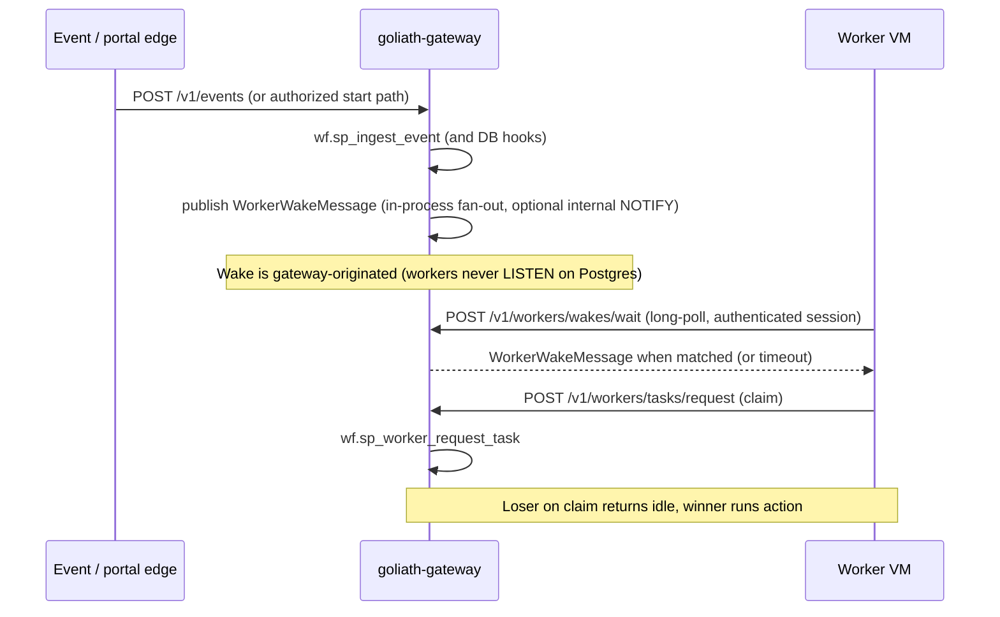

# Dual worker activation (tier 1)

## Product requirement (worker isolation)

**Workers must not connect to PostgreSQL for wakes, pub/sub, or any purpose.** They enroll, authenticate, **subscribe to wakes**, and **claim** only through **`goliath-gateway`** HTTP APIs (`contracts/openapi.yaml`, `goliath_worker.WorkflowRestClient`). The gateway alone holds database credentials; it publishes wakes after event ingest, workflow start, and related hooks. Wake delivery to workers is **gateway-mediated**: authenticated worker session on **`POST /v1/workers/wakes/wait`** (long-poll; set **`WORKER_WAKE_HTTP=1`** for `WorkflowRestClient.wait_idle_then_request_task`).

**Claim remains** `POST /v1/workers/tasks/request` — the **only** lease grant.

## Known defect: worker-side Postgres `LISTEN` (removed — do not adopt)

Older revisions exposed **`PostgresWorkerWakeSubscriber`** and env flags **`WORKER_WAKE_POSTGRES`** / **`WORKER_WAKE_PG_DSN`**, which opened a **direct** Postgres connection for `LISTEN` on worker hosts. **That pattern is rejected** — it violates isolation, spreads DSNs to fleet machines, and exposes the database to workers.

- **Do not** enable `WORKER_WAKE_POSTGRES` or `WORKER_WAKE_PG_DSN` for adopters; worker-side `LISTEN` is **removed** from this tree.
- **Use** gateway-mediated subscribe: **`POST /v1/workers/wakes/wait`** + **`WORKER_WAKE_HTTP=1`**.

GoliathApp and **goliath-gateway** support two ways to get idle workers moving toward READY work:

1. **Pull / claim (existing)** — workers call `POST /v1/workers/tasks/request` (`wf.sp_worker_request_task`). This remains the **safety net**, the **backlog path**, and the **only** path that grants a lease.
2. **Push wake** — after `POST /v1/events` or workflow start, the **gateway** publishes a **small wake** (pool / capability / program channel). Workers receive it **via the gateway** on the authenticated session (**`POST /v1/workers/wakes/wait`**), **interrupt idle wait**, then **still claim** so ownership stays single: **notify via gateway, own via claim**.

This document is tier **1** (shared platform). Product-specific wakes (for example tier-2 satellite I&T issue #3 in the satellite repo) and live OPC telemetry fan-out are **out of scope** here.

## Problem

Events already create or advance workflow instances (`POST /v1/events` → `wf.sp_ingest_event`). Workers today discover READY actions only by polling claim. That adds latency when the response should start immediately. Pure push without claim is a poor fit for long jobs: duplicate starts, lost messages, and ambiguous retries.

Dual activation keeps poll/claim semantics (heartbeats, fail/requeue, capability matching, fleet drain/stop) and adds a **hint** so idle workers wake sooner.

## Non-goals (this slice and tier 1)

| Topic | Status |
|-------|--------|
| Live tier-2 OPC telemetry in the claim loop | **Excluded** — telemetry uses a separate bus (publish once, many listeners), not leased work. |
| Product-specific wake channels (field I&T, tier-2 workload spikes) | **Tier 2** — builds on these channel names and DTOs. |
| Production Redis / NATS / other external wake bus behind the gateway | **Optional later** — workers still see **only** the gateway; the gateway adapts internal or external publish. |
| Workers using Postgres `LISTEN` / a wake DSN | **Rejected / removed** — workers must stay DB-isolated; wakes use **`POST /v1/workers/wakes/wait`** only. |
| Changing lease SQL (`wf.sp_worker_request_task`) | **Unchanged** |
| Replacing claim with message-carried task payloads | **Rejected** — wakes carry no `input_json` and no lease. |

## Notify vs own



- **Notify**: cheap, idempotent-friendly signal that *something* may be claimable for a pool/capability/program.
- **Own**: exactly one worker holds the lease after a successful claim; heartbeats and submit/fail unchanged.

## Wake message shape

JSON fields (see `goliath_worker.wake.WorkerWakeMessage`):

| Field | Required | Meaning |
|-------|----------|---------|
| `wake_id` | yes | Dedup key for subscribers (for example `event:{event_id}:{idempotency_key}`). |
| `reason` | yes | Producer label (for example `event_ingest:upload.landed`). |
| `pool` | one of pool / capability / program | Fleet pool or cluster key workers match. |
| `capability` | one of pool / capability / program | Narrow wake to workers with that capability. |
| `program_id` | one of pool / capability / program | Domain program id (tier 2 may add finer channels). |
| `event_id` | no | Source `wf.event.id` when wake follows ingest. |
| `workflow_instance_id` | no | Hint for observability; **not** a lease grant. |
| `occurred_at_utc` | no | ISO-8601 UTC timestamp; defaulted at publish time. |

Wakes **must not** include task input, node execution ids for claiming, or lease tokens.

### Event payload hints (optional override)

Adapters may attach optional overrides under `worker_wake`. When present, these fields **merge with** subscription-derived hints from the database (override rows first):

```json
{
  "event_type": "upload.landed",
  "source": "storage-adapter",
  "idempotency_key": "…",
  "payload": {
    "worker_wake": {
      "pool": "west",
      "capability": "align_bam",
      "program_id": "my-program@v1"
    }
  }
}
```

When `applied_count > 0`, the gateway loads claimable-task dimensions via `wf.fn_worker_wake_hints_for_event` (pool from instance `context_json.pool`, capability from READY actions, program from publish/study links). `payload.worker_wake` remains supported as an override; it is no longer required for wakes to fire.

## Channel naming

Prefix: `goliath.wake.v1`.

| Target | Channel pattern | Helper |
|--------|-----------------|--------|
| Pool | `goliath.wake.v1.pool.{pool}` | `wake_channel_for_pool` |
| Capability | `goliath.wake.v1.capability.{name}` | `wake_channel_for_capability` |
| Program | `goliath.wake.v1.program.{program_id}` | `wake_channel_for_program` |

Segments are normalized (unsafe characters → `_`). A message may publish to **multiple** channels when more than one dimension is set.

### Postgres `NOTIFY` channel mapping (gateway implementation detail)

When **`WF_WAKE_POSTGRES=1`**, the gateway may use Postgres `NOTIFY` as an **internal** transport on a dedicated **gateway** connection. Channel identifiers are limited to **63 characters** and must not rely on `.` (logical names use dots). The gateway maps logical names to NOTIFY identifiers without changing the JSON payload (`WorkerWakeMessage`). **Workers do not use this mapping** — only gateway code may call `NOTIFY` / hold the DSN.

| Logical (pub/sub API) | Postgres `NOTIFY` channel |
|-----------------------|---------------------------|
| `goliath.wake.v1.pool.{segment}` | `gw1_pool_{segment}` |
| `goliath.wake.v1.capability.{segment}` | `gw1_capability_{segment}` |
| `goliath.wake.v1.program.{segment}` | `gw1_program_{segment}` |

Implementation: `goliath_worker.wake.logical_wake_channel_to_pg_notify`. Underscores in `{segment}` are preserved. When the NOTIFY name would exceed 63 characters, the channel becomes `gw1_{kind}_h{sha256(logical)[:16]}` (truncated to 63).

**Subscription:** workers register interest using the union of channels implied by enrollment (pool), declared **capabilities**, and optional program binding — tier 2 may refine rules. `WorkflowRestClient.wake_channels_for_enrollment` builds that **logical** list; the gateway’s **`POST /v1/workers/wakes/wait`** intersects it with each published wake. Idle wait should **wake then always claim**.

**Historical:** `wait_idle_then_request_task` + direct Postgres `LISTEN` is **removed**; see “Known defect” above.

## Failure modes

| Scenario | Behavior |
|----------|----------|
| **Lost wake** | Worker stays idle until the next claim poll (existing backoff). Poll remains the safety net. |
| **Duplicate wake** | Harmless; multiple workers wake and **claim**; `wf.sp_worker_request_task` gives at most one lease; losers get empty claim and return to idle/wait. |
| **Wake without matching READY work** | Claim returns idle; worker returns to wait or polls. |
| **Publisher / internal bus down** | With `WF_WAKE_POSTGRES` unset, there is no cross-process NOTIFY; single-process gateways still get in-memory fan-out. Empty `wait` responses still lead to claim after timeout (safety net). |
| **Stale wake_id** | Subscribers may ignore repeats; claim is authoritative. |

## Gateway publish hooks

| Edge | Status | Notes |
|------|--------|-------|
| `POST /v1/events` after `wf.sp_ingest_event` | **Automatic** | Hint query + optional `payload.worker_wake` override; fan-out when enabled. |
| `sp_start_workflow_instance` (portal/API) | **Automatic** | Gateway publishes after start via `publish_wakes_after_workflow_instance_start`. |
| Lease reclaim → READY | **Helper** | `publish_wakes_after_lease_reclaim` for non-quiet reclaim callers; claim-path quiet reclaim uses poll safety net. |
| Tier-2 product wakes | **Hook** | `worker_wake_tier2.register_tier2_wake_extension` (satellite tier-2 issue #3). |

Implementation entry points:

- `workflow_engine/rest/gateway.py` — injectable `wake_publisher`, `WorkerWakeHub`, `POST /v1/workers/wakes/wait`.
- `workflow_engine/rest/worker_wake.py` — ingest/start/reclaim publish helpers, hint merge, tier-1 publish.
- `workflow_engine/rest/worker_wake_tier2.py` — tier-2 extension registration stub.
- `workflow_engine/rest/wake_coalesce.py` — debounced publisher wrapper (NOTIFY burst control, payload size guard).
- `workflow_engine/rest/worker_wake_hub.py` — in-process fan-out from publish to HTTP waiters.
- `workflow_engine/sql_pg/wf_worker_wake_hints.sql` — `fn_worker_wake_hints_for_{event,instances,node_executions}`.
- `workflow_engine/sql_pg/wf_worker_session_api.sql` — `fn_worker_resolve_session_for_wake` (session validation for wait).
- `goliath_worker/wake.py` — DTO, channel helpers, NOTIFY mapping, `WorkerWakePublisher` / `WorkerWakeSubscriber` protocols, null implementations.
- `goliath_worker/postgres_wake.py` — gateway-only `PostgresWorkerWakePublisher` (NOTIFY).
- `goliath_worker/http_wake.py` — `HttpWorkerWakeSubscriber` (long-poll client).
- `workflow_engine/rest/postgres_wake.py` — `resolve_wake_publisher` for gateway startup.

## Worker subscribe while idle (required design)

**Target idle loop** for descendant worker processes (gateway-only; claim unchanged):

1. Open gateway **worker session** (`POST /v1/workers/session` or enroll with session).
2. Set **`WORKER_WAKE_HTTP=1`** and use `WorkflowRestClient.wait_idle_then_request_task` (or call **`POST /v1/workers/wakes/wait`** directly). The gateway validates the same **`Authorization: Bearer`** + **`X-Goliath-Worker-Token`** + JSON **`worker_id`** as claim and **rejects** unauthenticated subscribe attempts.
3. On wake **or** `timeout_seconds` expiry: **`POST /v1/workers/tasks/request`** (unchanged claim path — timeout is the safety net).
4. If claim empty: return to step 2. If claim wins: continue work; heartbeats / submit / fail unchanged.

`goliath_worker.wake.NullWorkerWakeSubscriber` and **timed claim polling** remain valid: **poll-only** when **`WORKER_WAKE_HTTP`** is unset.

### HTTP wait API

- **Path:** `POST /v1/workers/wakes/wait`
- **Auth:** Same as `POST /v1/workers/tasks/request` (session bearer + identity header + JSON `worker_id`).
- **Body:** `{ "worker_id": <int>, "timeout_seconds": <float, optional, max 120>, "program_id": "<optional string>" }`
  - `program_id` is optional; when set, the gateway also matches `goliath.wake.v1.program.{program_id}` for this wait.
- **Response:** `{ "wake": <WorkerWakeMessage JSON or null>, "timed_out": <bool> }`

Session validation uses `wf.fn_worker_resolve_session_for_wake` (touches the session like claim).

### Configuration

| Variable | Component | Meaning |
|----------|-----------|---------|
| `WF_WAKE_POSTGRES=1` | Gateway | Optional: Postgres `NOTIFY` **inside the gateway** on the gateway DSN (debounced). Default off. |
| `WORKER_WAKE_HTTP=1` | Worker | Use `POST /v1/workers/wakes/wait` inside `wait_idle_then_request_task` (no worker DSN). |
| `WORKER_WAKE_PROGRAM_ID` | Worker | Optional extra program channel for long-poll when not passed in the wait body. |
| `WORKER_WAKE_POLL_SECONDS` | Worker | Default long-poll / idle timeout before claim safety-net (default `30`). |
| `WF_WAKE_COALESCE_SECONDS` | Gateway | Debounce for coalesced Postgres NOTIFY (default `0.05`; `0` flushes immediately). Does not apply to in-memory HTTP fan-out. |

#### Removed / superseded (do not use)

| Variable | Status |
|----------|--------|
| `WORKER_WAKE_POSTGRES`, `WORKER_WAKE_PG_DSN` | **Removed** — worker LISTEN path; **do not** set. |
| `PostgresWorkerWakeSubscriber` | **Removed** from worker codepaths (gateway-only NOTIFY publisher remains). |

## Security

- **Subscribe requires worker session** — same bearer session as claim (`Authorization: Bearer` + identity header + `worker_id` on gateway routes). Anonymous subscribers must not receive fleet wakes (capability and pool metadata leaks work queue shape).
- **Publish is gateway-side** — only trusted gateway code (after DB ingest or authorized portal paths) holds credentials for internal or external wake transport; **workers never receive a database DSN for wakes**.
- Wakes carry **no secrets** and no PII by convention; adapters should keep hints minimal.

## Rollout plan

1. **Done (PR #23)** — design doc, DTO/protocol stubs, `NullPublisher` default, event-ingest hook, tests for channel naming and payload parsing.
2. **Done (PR #24)** — Postgres `NOTIFY` experiment (gateway publish + worker `LISTEN`); worker direct DB path **superseded** by gateway-only HTTP subscribe.
3. **This slice** — gateway `POST /v1/workers/wakes/wait`, automatic subscription-derived wakes, coalesced NOTIFY (optional), instance-start publish, tier-2 hook stub, integration tests.
4. **Tier 2** — Satellite product channels and OPC/telemetry separation (issue #3).
5. **Operate** — metrics on wake publish count, claim latency p50/p95 with wakes enabled, duplicate wake rate vs empty claims.

## Related docs

- [workers.md](workers.md) — claim loop and sessions
- `workers/WORKER_PROTOCOL.md` (repository root) — HTTP contract including wake fields
- GitHub: [GoliathApp #22](https://github.com/Goliath-Research/GoliathApp/issues/22)

## Follow-ups for child apps

Repos that previously set **`WORKER_WAKE_POSTGRES`** or **`WORKER_WAKE_PG_DSN`** must switch workers to **`WORKER_WAKE_HTTP=1`** and the same gateway base URL as claim (`GOLIATH_API_BASE`). No database variables are required on workers for wakes.
