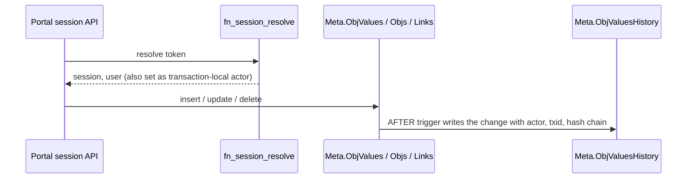
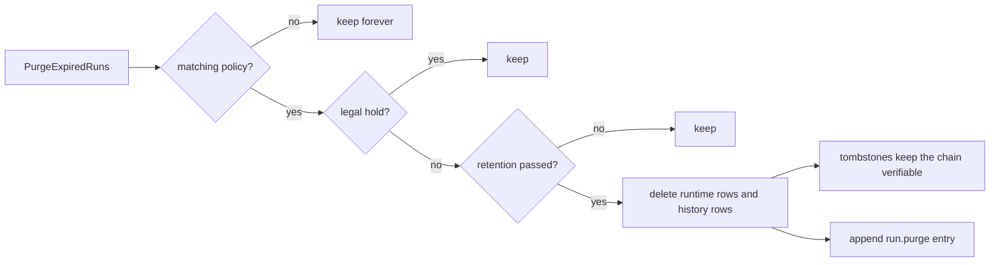

# History and audit

GoliathApp keeps a complete, tamper-evident history of what happened on the platform. History must
exist with no gaps: a record is never silently changed or removed, and anything removed under a
retention policy leaves a verifiable trace.

This page is built up by a stack of pull requests:

| Slice | What it adds | Status |
|-------|--------------|--------|
| **H1 — Ledger core** | Append-only, hash-chained ledgers for every platform audit table and the event plane; verification and checkpoints | Sections 1–4 |
| **H2 — Meta object history** | `"Meta"."ObjValuesHistory"`: every object value, object lifecycle, instance link and scope change, attributed; point-in-time reads | Section 5 |
| **H3 — Run history and retention** | `wf.run_history` ledger of run transitions and worker leases; runs cannot be deleted except by a `platform/RetentionPolicy` purge that leaves tombstones and a purge record | Section 6 |
| H4 — Electronic signatures | `platform/ElectronicSignature`: signer, meaning, time and content hash bound to a record | Follow-up PR |

## 1. Ledgers

A **ledger** is a table whose rows are facts. `workflow_engine/sql_pg/platform_history_ledger.sql`
registers a table with `portal.sp_ledger_register(ledger_name, table, order_by, description, dedupe_columns)`.
Registration:

* adds four columns: `ledger_seq` (contiguous per ledger), `txid` (the writing transaction),
  `prev_hash` and `row_hash`;
* chains the rows that already exist, oldest first, the first time the table is registered (so an
  existing deployment keeps its history);
* installs `trg_ledger_before_insert`, `trg_ledger_guard` (UPDATE / DELETE) and
  `trg_ledger_no_truncate`, and revokes UPDATE / DELETE / TRUNCATE from `PUBLIC`.

Registered by the platform:

| Ledger | Table | Records |
|--------|-------|---------|
| `portal.record_editor_audit` | `portal.record_editor_audit` | Record editor saves, deletes, fleet and run actions |
| `portal.model_authoring_audit` | `portal.model_authoring_audit` | Child-namespace model authoring |
| `portal.security_admin_audit` | `portal.security_admin_audit` | Users, roles, grants, class and object ACLs |
| `portal.god_architect_audit` | `portal.god_architect_audit` | `platform/*` catalog changes and God Architect grants |
| `portal.session_active_role_audit` | `portal.session_active_role_audit` | Active role per session |
| `portal.external_identity_link_audit` | `portal.external_identity_link_audit` | External identity links at first sign-in |
| `onboarding.audit_log` | `"Onboarding"."AuditLog"` | Invitation lifecycle |
| `wf.event` | `wf.event` | Ingested events (deduplicated on `source`, `idempotency_key`) |
| `wf.event_delivery` | `wf.event_delivery` | How each event was applied |

`wf.event_delivery` no longer has foreign keys to runs, nodes or subscriptions: a history row keeps the
id it referred to even when the referenced runtime row is retired. Deleting a subscription keeps its
recorded events and deliveries, as before.

## 2. Hash chain

For each new row the insert trigger takes the ledger head (`portal.ledger_head`, locked for the rest
of the transaction), assigns `ledger_seq = last_seq + 1`, and computes

```text
row_hash = sha256(prev_hash || canonical_json(row without row_hash, null keys removed))
```

with `TimeZone = UTC`, `bytea_output = hex` and fixed float output, so the bytes are identical in
every session. Null keys are removed so a ledger table can later gain nullable columns without
changing old hashes. Ledger tables must only gain **nullable columns without defaults**.

Ledgers that use `INSERT … ON CONFLICT DO NOTHING` (event ingest) register `dedupe_columns`; a duplicate
is skipped before it takes a sequence number, so idempotent ingest never creates a gap.

The head lock serializes writers of one ledger until commit. Audit volumes are small; high-volume
ledgers added later (run history) keep their transactions short.

## 3. What is refused

| Operation | Result |
|-----------|--------|
| `UPDATE` on a ledger row | `GS409 … append-only: rows cannot be updated` |
| `DELETE` | `GS409` unless the transaction holds a purge authorization for that ledger |
| `TRUNCATE` | `GS409` |

A purge authorization is a row in `portal.ledger_purge_authorization` for the current transaction id.
Only platform `SECURITY DEFINER` functions write it (H3 adds the retention purge). Each purged row
leaves a `portal.ledger_tombstone` (sequence number and row hash), so the chain still links through it.

## 4. Verification and checkpoints

| Function | Returns |
|----------|---------|
| `portal.fn_ledger_verify(ledger)` | One row per problem; empty means intact |
| `portal.fn_ledger_verify_all()` | Problems across every ledger |
| `portal.fn_ledger_checkpoint()` | `ledger_name`, `last_seq`, `last_hash_hex` for each ledger |

Problems:

| Problem | Meaning |
|---------|---------|
| `missing_seq` | A sequence number has neither a row nor a tombstone: rows were removed outside a purge |
| `prev_mismatch` | `prev_hash` does not equal the previous entry's hash |
| `hash_mismatch` | Row content changed after it was written |
| `head_mismatch` | The head does not match the last entry |

**Threat model.** The guards stop every application role and every ordinary mistake. A database owner
can still disable triggers; the hash chain then exposes any edit or deletion on the next verification.
To make even a rewritten chain detectable, store `portal.fn_ledger_checkpoint()` output outside the
database on a schedule (for example in your document management system or object storage with
retention lock) and compare later checkpoints against it.

```sql
SELECT * FROM portal.fn_ledger_verify_all();   -- expect no rows
SELECT * FROM portal.fn_ledger_checkpoint();   -- export and keep
```

## 5. Meta object history

Every change to a Meta object is written to `"Meta"."ObjValuesHistory"`, for **every class**. History
is not opt-in: `HasHistory` on `"Meta"."Classes"` is kept for legacy parity and no longer decides
anything. The table is the ledger `meta.obj_values_history`, so it is append-only and hash-chained like
the audit tables, and it has no foreign keys: history outlives the objects it describes.

| Change kind | Written when |
|-------------|--------------|
| `object.create`, `object.delete`, `object.reclass` | A row of `"Meta"."Objs"` is inserted, deleted, or changes class |
| `values.insert`, `values.update`, `values.delete` | A class level of `"Meta"."ObjValues"` changes. `DataBefore` and `DataAfter` hold the level's values. An update that changes nothing writes nothing |
| `link.create`, `link.update`, `link.delete` | An instance link (`"Meta"."Links"` with `ObjID1` set) changes. Class-level link definitions are not object history |
| `object.scope`, `object.unscope` | The object's tenant scope (`portal."ScopedMetaObjects"`) is set or removed |
| `object.baseline`, `values.baseline`, `link.baseline`, `scope.baseline` | The state that existed when history was first installed |



**Attribution.** `portal.fn_session_resolve` stores the resolved user and session in the
transaction-local settings `goliath.actor_user_id` and `goliath.actor_session_id`; history rows copy
them into `ActorUserID` and `ActorSessionID`. Every row also has `DbRole` (the database role that made
the change) and `txid`, which joins to the audit ledgers written in the same transaction. Changes made
outside a portal session (apply scripts, maintenance) have no actor user and are identified by role and
transaction.

**Reading history.**

| Function | Use |
|----------|-----|
| `portal.sp_session_meta_obj_history(token, obj_id)` | Session API. A live object needs the same read rights as `sp_session_meta_obj_get`; a deleted object's history is readable in the scope it last belonged to, with `meta.object.read` there |
| `"Meta".fn_obj_history(obj_id)` | Owner-only: every change of the object, oldest first |
| `"Meta".fn_obj_values_as_of(obj_id, at_utc)` | Owner-only: each class level's values at a point in time |
| `"Meta".fn_merged_obj_document_as_of(obj_id, at_utc)` | Owner-only: the merged document at a point in time, the historical counterpart of `"Meta".fn_merged_obj_document` |

The owner-only functions are not executable by application roles because they bypass tenant checks.

## 6. Workflow run history and retention

`wf.workflow_instance`, `wf.node_execution` and `wf.task_lease` are runtime state: workers update them
constantly and a lease row exists only while a task is held. The run record is kept separately in the
ledger `wf.run_history`:

| Change kind | Written when |
|-------------|--------------|
| `instance.create`, `instance.status` | An instance is created or changes status |
| `node.create`, `node.status` | A node execution is created or changes status. Finished statuses also keep the output, result and error codes, and the worker that completed it |
| `lease.acquire`, `lease.transfer`, `lease.release` | A worker takes, hands over or gives back a task. Heartbeats are not recorded |
| `run.purge` | A run was removed under a retention policy (see below) |
| `instance.baseline`, `node.baseline` | Runs that existed when run history was installed |

**Runs are not deleted.** Deleting or truncating `wf.workflow_instance` or `wf.node_execution` is
refused. `wf.sp_delete_workflow_def(..., p_delete_instances => true)` no longer cascades: it removes the
definition's runs through the retention purge, and fails without changing anything if any run may not
be purged.

**Retention policies are Meta objects.** `platform/RetentionPolicy` is a platform class, so only God
Architect can create or change policies:

| Field | Meaning |
|-------|---------|
| `Label` | Display label |
| `RecordKind` | What the policy governs; `wf.run` is workflow runs |
| `WorkflowName` | Optional: limit the policy to one workflow definition |
| `RetentionDays` | Days a finished run is kept before it may be purged |
| `LegalHold` | When true, nothing the policy governs may be purged |

Its method `PurgeExpiredRuns` is implemented by
`wf.sp_purge_run_history(workflow_instance_ids, reason, require_all)`. For each run:

1. With no matching policy the run is kept forever.
2. A policy naming the workflow decides over general ones; among equals the longest retention wins.
3. A legal hold on any matching policy blocks the purge.
4. A run that is not finished is kept, unless the deciding policy has zero retention days.
5. A finished run is purged once `RetentionDays` have passed since it completed.

`wf.fn_run_purge_blockers(instance_id)` explains why a run cannot be purged yet. A purge deletes the
runtime rows and the run's history rows. Every removed history row leaves a tombstone, so the chain
still verifies. A new `run.purge` entry records the policy, how many node executions and history rows
were removed, the reason and the actor.



Run history is written in the same transaction as each status change and serializes writers on the
ledger head, which is the price of a gap-free chain. Test databases that recreate fixtures create an
explicit zero-day policy for their own test workflow; production has no policy until one is created
deliberately.
