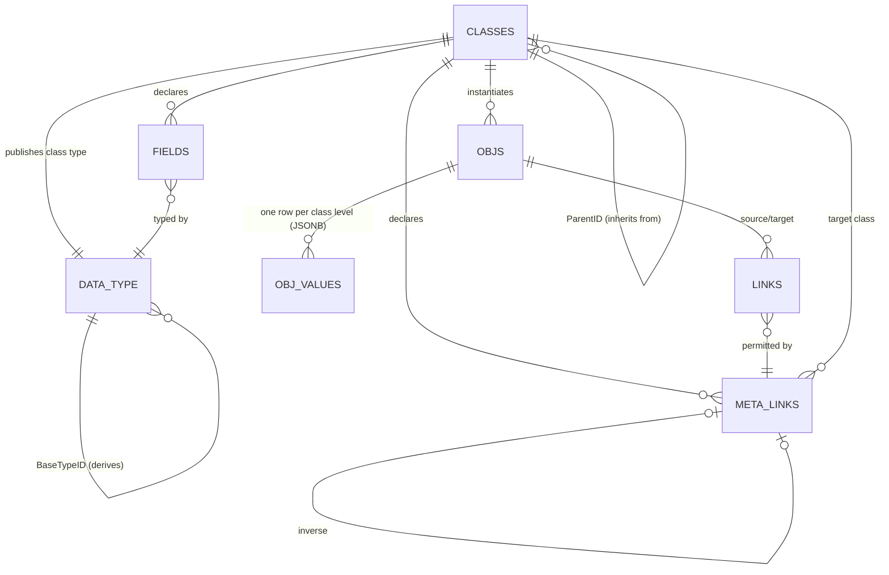

# Meta model redesign (design, not yet implemented)

Status: **proposed** — for review by David Izada Rodriguez. No implementation code in this PR. Decisions D1–D3 recorded in §10.

## 1. Current state (audited at `a50874c`)

| Area | Today | Gap |
| --- | --- | --- |
| Classes | `workflow_engine/sql_pg/meta_schema.sql:7-14` — `"Meta"."Classes"(ID, Name, TableName, ParentID, HasHistory)` | `ParentID` has no FK, no cycle check, no abstract flag; meaning is implicit |
| Objects | `meta_schema.sql:72-76` — `"Meta"."Objs"(ID, ClassID)`; values in per-class typed tables sharing `ID` | No JSON value, no schema |
| Hierarchy walk | `meta_api_parity.sql` `spinsertobject` (159-222) / `spupdateobject` (224-275) use `WITH RECURSIVE` over `ParentID` | Unbounded recursion on cycles; JSON keys not matching a column are **silently dropped**; only type casts validate |
| Field lookup | `fngetclassfields` / `fngetclassfieldswithtypes` (40-68) | Own table only, ancestors ignored |
| DDL generation | `spclasscreatetablesql/viewsql/historysql`, `spclassadded` (294-320) | Stubs that `RAISE EXCEPTION 'not ported'` |
| Delete | `spclassdelete` (278-289) | Recurses children, deletes nothing |
| Types | `wf_data_type.sql` — `wf.data_type(kind, schema_json, element_type_id)` + `wf.data_type_field`; migration `20260824_data_type_schema_json.sql` | No type derivation; separate from Meta |
| Semantic | `goliath_app/semantic/export.py` — Pydantic `model_json_schema` per entity | Not linked to Meta classes |
| Tests | none reference `"Meta"` | — |

## 2. Target model



### 2.1 Single inheritance

`ParentID` means strictly *inherits from*. Trees of objects no longer use it (see §6).

```sql
ALTER TABLE "Meta"."Classes"
  ADD COLUMN "IsAbstract" boolean NOT NULL DEFAULT false,
  ADD COLUMN "AncestorPath" int[] NOT NULL DEFAULT '{}',   -- root..parent, cached
  ADD COLUMN "Depth" int NOT NULL DEFAULT 0,
  ADD COLUMN "TypeID" bigint NULL REFERENCES wf.data_type(id),  -- published class type
  ADD CONSTRAINT "FK_Classes_Parent" FOREIGN KEY ("ParentID") REFERENCES "Meta"."Classes"("ID"),
  ADD CONSTRAINT "CK_Classes_NotSelf" CHECK ("ParentID" IS DISTINCT FROM "ID");

CREATE TABLE "Meta"."ClassClosure" (          -- ancestor/descendant pairs, incl. self (depth 0)
  "AncestorID" int REFERENCES "Meta"."Classes" ON DELETE CASCADE,
  "DescendantID" int REFERENCES "Meta"."Classes" ON DELETE CASCADE,
  "Depth" int NOT NULL,
  PRIMARY KEY ("AncestorID","DescendantID"));

-- BEFORE INSERT/UPDATE OF "ParentID": reject if NEW."ID" = ANY(parent.AncestorPath || parent.ID);
-- AFTER: recompute AncestorPath/Depth/closure for NEW and all descendants, then regenerate views (§5).
CREATE FUNCTION "Meta".trg_classes_hierarchy() RETURNS trigger ...;
```

Rules:
- One parent. Abstract classes cannot be instantiated (`Objs` insert trigger checks `IsAbstract`).
- Members (methods, fields, meta links) are resolved **by name, nearest definition wins** (lowest `Depth` in the closure).
- Overrides may only **narrow**: a field's type must be the same as, or derived from (§3), the inherited type; `Required` may go false→true, not back; a meta link may narrow target class to a descendant and cardinality (e.g. `0..*` → `0..1`), never widen. Violations are rejected by the `Fields`/`MetaLinks` triggers.
- Re-parenting a class with existing objects is rejected unless the new chain is a superset (only adds ancestors with no required fields).

Resolution view:

```sql
CREATE VIEW "Meta"."VClassFieldsResolved" AS
SELECT DISTINCT ON (cc."DescendantID", f."Name")
  cc."DescendantID" AS "ClassID", f.*, cc."Depth" AS "DefinedAtDepth"
FROM "Meta"."ClassClosure" cc JOIN "Meta"."Fields" f ON f."ClassID" = cc."AncestorID"
ORDER BY cc."DescendantID", f."Name", cc."Depth";
```

### 2.2 Fields

```sql
CREATE TABLE "Meta"."Fields" (
  "ID" int GENERATED ALWAYS AS IDENTITY PRIMARY KEY,
  "ClassID" int NOT NULL REFERENCES "Meta"."Classes" ON DELETE CASCADE,
  "Name" text NOT NULL,
  "TypeID" bigint NOT NULL REFERENCES wf.data_type(id),
  "Required" boolean NOT NULL DEFAULT false,
  "IsHot" boolean NOT NULL DEFAULT false,      -- becomes a generated column (§4)
  "Description" text,
  UNIQUE ("ClassID","Name"));
```

### 2.3 Methods

Methods are declared in Meta. Like fields, they're inherited and overridden by name.

```sql
CREATE TABLE "Meta"."Methods" (
  "ID" int GENERATED ALWAYS AS IDENTITY PRIMARY KEY,
  "ClassID" int NOT NULL REFERENCES "Meta"."Classes" ON DELETE CASCADE,
  "Name" text NOT NULL,
  "Description" text,
  "ReturnTypeID" bigint NULL REFERENCES wf.data_type(id),   -- NULL = void
  "IsAbstract" boolean NOT NULL DEFAULT false,              -- no implementation; class must be abstract
  "IsOverride" boolean NOT NULL DEFAULT false,              -- must match an inherited method
  "IsFinal" boolean NOT NULL DEFAULT false,                 -- cannot be overridden
  "ImplKind" text NULL CHECK ("ImplKind" IN ('sql','action','python')),
  "ImplRef" text NULL,     -- proc regprocedure text | wf action name/version | python dotted path
  UNIQUE ("ClassID","Name"),
  CHECK ("IsAbstract" = ("ImplKind" IS NULL)));

CREATE TABLE "Meta"."MethodParams" (
  "MethodID" int NOT NULL REFERENCES "Meta"."Methods" ON DELETE CASCADE,
  "Ordinal" int NOT NULL,
  "Name" text NOT NULL,
  "TypeID" bigint NOT NULL REFERENCES wf.data_type(id),
  "Required" boolean NOT NULL DEFAULT true,
  "DefaultValue" jsonb NULL,          -- validated against the param type
  PRIMARY KEY ("MethodID","Ordinal"), UNIQUE ("MethodID","Name"));
```

Rules:
- **Resolution:** nearest definition wins (through `ClassClosure`), the same as for fields. A `VClassMethodsResolved` view gives the effective method per class.
- **Abstract methods:** a concrete class must resolve every abstract method to a concrete one; this is checked when `IsAbstract` is set to false and when objects are inserted.
- **Signature compatibility on override (narrowing):**
  - Same parameter names, in the same order.
  - An override can't add a new required parameter; it may add an optional one at the end.
  - A parameter's type must be the same as the inherited one. Changing it in either direction would break calls made through the parent's signature, so input types are invariant.
  - A required parameter can't become optional or the other way round, except that an override may relax required → optional.
  - The return type may narrow to a derived type (covariant).
  - `IsOverride` must be true exactly when an inherited method exists, and a `IsFinal` method can't be overridden.
- **Implementation mapping:**
  - `sql`: a stored proc taking `(self_id int, args jsonb)`.
  - `action`: a `wf.workflow_action` whose `input_type_id` is the method's parameter type (below).
  - `python`: a handler registered in the semantic/action registry.
  - `Meta.sp_invoke(obj_id, method, args jsonb)` resolves the method for the object's class, validates `args`, then dispatches.
- **Parameter schema:** `Meta.fn_method_params_json_schema(method_id)` builds a draft 2020-12 object schema from `MethodParams`: each parameter's type is a `$ref`, `required` and `default` come from the table, and `unevaluatedProperties: false`. It's published as a catalog type (`<Class>.<Method>.Params`) so ActionSpecs and the portal use it directly. The return type is already a catalog type.

## 3. Meta links vs instance links

- **Meta link**: declared on a class — name, target class, cardinality, optional inverse, `IsHierarchical`.
- **Instance link**: a real edge between two `Objs`; it must reference a meta link that is resolved for the source object's class and whose target class is an ancestor-or-self of the target object's class.

```sql
CREATE TABLE "Meta"."MetaLinks" (
  "ID" int GENERATED ALWAYS AS IDENTITY PRIMARY KEY,
  "ClassID" int NOT NULL REFERENCES "Meta"."Classes",
  "Name" text NOT NULL,
  "TargetClassID" int NOT NULL REFERENCES "Meta"."Classes",
  "MinCard" int NOT NULL DEFAULT 0,
  "MaxCard" int NULL,                         -- NULL = unbounded
  "InverseID" int NULL REFERENCES "Meta"."MetaLinks",
  "IsHierarchical" boolean NOT NULL DEFAULT false,
  UNIQUE ("ClassID","Name"));

-- existing "Meta"."Links" gains:
ALTER TABLE "Meta"."Links" ADD COLUMN "MetaLinkID" int NOT NULL REFERENCES "Meta"."MetaLinks";
-- trigger: permitted-by check, MaxCard check, inverse row maintenance.
```

`MinCard` is checked by a deferred constraint trigger at commit.

## 4. Catalog data types, JSON Schema and JSONB values

### 4.1 One catalog: extend `wf.data_type`

Don't create a second type table. Add to `wf.data_type`:

```sql
ALTER TABLE wf.data_type
  ADD COLUMN description text,
  ADD COLUMN base_type_id bigint NULL REFERENCES wf.data_type(id),  -- derivation
  ADD COLUMN class_id int NULL REFERENCES "Meta"."Classes"("ID"); -- set for class-published types
```

`schema_json` holds the type's **own fragment**. The effective schema is `{"allOf":[base_effective, own_fragment]}`. Example: `Percent` = base `Decimal` (`{"type":"number"}`) + `{"minimum":0,"maximum":100}`. "Narrowing" (§2.1) means "the overriding type is the same type or a descendant through `base_type_id`".

### 4.2 Generated class schema

`"Meta".fn_class_json_schema(class_id)` returns:

```json
{
  "$schema": "https://json-schema.org/draft/2020-12/schema",
  "$id": "goliath:meta/class/Sample",
  "allOf": [ { "$ref": "goliath:meta/class/Specimen" } ],
  "type": "object",
  "properties": { "Barcode": { "$ref": "goliath:type/Barcode" } },
  "required": ["Barcode"],
  "unevaluatedProperties": false
}
```

- **Draft 2020-12**, because with `allOf` composition only `unevaluatedProperties: false` rejects unknown keys while still seeing the parent's properties (`additionalProperties` can't). Draft 2020-12 is also what Pydantic v2 `model_json_schema` emits (`semantic/export.py`), so semantic entities and Meta classes use the same dialect.
- For validation the function also gives a **bundled** form (with `$defs` inlined) because the validator can't fetch `$ref` URIs.
- The schema is stored in the class's `wf.data_type.schema_json` (kind `object`, `class_id` set). It's regenerated when any class, field or ancestor changes.

### 4.3 Storage: JSONB per class level

```sql
CREATE TABLE "Meta"."ObjValues" (
  "ObjID" int NOT NULL REFERENCES "Meta"."Objs" ON DELETE CASCADE,
  "ClassID" int NOT NULL REFERENCES "Meta"."Classes",   -- the level that declares these fields
  "Data" jsonb NOT NULL DEFAULT '{}',
  PRIMARY KEY ("ObjID","ClassID"));
```

Each object has one row per class in its chain (root to leaf). The keys in a row are the fields declared at that level (a key moves to the overriding level). One unpartitioned table (Decision D3). Indexes: PK B-tree `(ObjID, ClassID)` plus B-tree `(ClassID)`; GIN `jsonb_path_ops` on `Data`. Hot fields become **generated columns** on `ObjValues`, e.g. `"Barcode" text GENERATED ALWAYS AS ("Data"->>'Barcode') STORED`, with partial B-tree indexes `WHERE "ClassID" = <level>`.

### 4.4 Validation

- `Meta.sp_obj_insert(class_id, jsonb)` / `sp_obj_update(obj_id, jsonb patch)` replace `spinsertobject` / `spupdateobject`. They split the document by level using `VClassFieldsResolved` and **raise on unknown keys**. Today those keys are dropped silently.
- A `BEFORE INSERT OR UPDATE` trigger on `ObjValues` checks the merged document against the bundled class schema. The trigger also covers direct DML, so nothing can skip validation.
- **Engine: `pg_jsonschema`** (`jsonb_matches_schema` / `jsonschema_is_valid`). On 2026-11-04 Neon's extension list showed it supported as 0.3.3 on PG14–17 and 0.3.4 on PG18 (https://neon.com/docs/extensions/pg-extensions). It's Rust (`jsonschema` crate) and supports 2019-09/2020-12.
  - Alternatives rejected: PL/pgSQL (too much to implement by hand to cover the keywords we need); plv8 (Neon blocks new installs); Python-only validation (doesn't cover direct SQL writes).
  - Python (`jsonschema` lib) still runs the same schema in the semantic/action layer to give users earlier, friendlier errors.
  - **Open:** confirm `unevaluatedProperties` and `$ref`-free bundles behave as expected under the Neon pg_jsonschema build; if not, fallback = PL/pgSQL key check plus pg_jsonschema on draft-7 with flattened properties.

## 5. Recursive class views

`"Meta"."V<Class>"` = parent class view + this level's fields:

```sql
CREATE OR REPLACE VIEW "Meta"."VSample" AS
SELECT p.*, (v."Data"->>'Barcode')::text AS "Barcode"
FROM "Meta"."VSpecimen" p
JOIN "Meta"."ObjValues" v ON v."ObjID" = p."ID" AND v."ClassID" = 12;
-- root view selects from "Meta"."Objs" o WHERE o."ClassID" IN (descendants of root)
```

- A view for class C includes objects of every descendant class (polymorphic select), because the root view filters through `ClassClosure`.
- `Meta.sp_class_regenerate_views(class_id)` (re)creates the views top-down for the class and all its descendants. It runs from the hierarchy/field triggers (or is deferred to commit via a dirty-class queue). It replaces the stubs `spclasscreatetablesql`, `spclasscreateviewsql`, `spclasscreatehistorysql` and `spclassadded`, which are then dropped.
- History: one `"Meta"."ObjValuesHistory"` table (jsonb snapshot + op + ts) replaces the per-class history DDL. `HasHistory` stays.

## 6. Trees

`ParentID` on `Classes` is inheritance only. For object trees:

- Declare a meta link with `IsHierarchical = true` (self or ancestor target, `MaxCard=1` toward the parent).
- Catalog type **`Tree`**: the hierarchy is kept in `"Meta"."TreeNodes"(ObjID, MetaLinkID, Path ltree)`. A trigger maintains `Path` when hierarchical links change, rejects cycles (new parent's path must not contain the node), and rewrites subtree paths when a node moves. A GiST index on `Path` makes `<@` / `@>` subtree and ancestor queries fast. Neon supports `ltree` (1.2–1.3).
- Catalog type **`TreeRef`**: `{"node": <ObjID>, "scope": "node"|"branch"}`. A field can point at one node or a whole subtree, and a trigger checks that the node exists.
- **Future adopter:** NavTree (portal navigation) moves onto `Tree` once this is in.

## 7. Integration

- **Semantic layer**: semantic entities can be backed by `"Meta"."V<Class>"`. `semantic/export.py` publishes the class catalog type's schema and stops deriving a separate Pydantic one for Meta-backed entities.
- **Actions**: `wf.workflow_action.input_type_id`/output already reference `wf.data_type`. Class types live in the same table, so an ActionSpec can take or return a class instance directly.
- **Exograph / portal**: both read the same catalog (`wf.data_type` + Meta views). The Exograph model (`deploy/targets/goliath-exo*.json`) is generated from the catalog instead of written by hand.

## 8. Migration path

1. Add the new columns/tables; backfill `AncestorPath`/closure. Run a cycle report first and fix bad rows by hand.
2. Add the FK and cycle trigger. Mark the obvious bases abstract (manual review).
3. No tree reclassification: no existing `ParentID` rows are trees (Decision D1). NavTree adopts `Tree` separately.
4. Build `Meta.Fields` from `information_schema.columns` of each per-class table, and map SQL types to catalog types.
5. Copy rows from the per-class tables into `ObjValues` (`to_jsonb(row) - 'ID'`), validating in report mode (log, don't reject).
6. Create the class views under the old table names as compatibility views, keep the old tables read-only for one release, then drop them.
7. Switch on enforcing validation; drop the old `sp*` and stubs.

## 9. Test plan (there are none today)

pgTAP (supported on Neon) for SQL plus pytest for Python:
- Inheritance: FK; cycle rejection (self, 2-cycle, deep); abstract instantiation rejected; closure/path correct after re-parenting.
- Overrides: narrowing accepted, widening rejected (type, Required, link target, cardinality); nearest-wins resolution.
- Links: instance link without a permitting meta link rejected; Max/MinCard; inverse maintenance.
- Schema: golden-file `fn_class_json_schema` output; `allOf` chain; unknown key rejected; derived type bounds (Percent 101 rejected).
- Storage: per-level split; generated hot columns; direct DML bypass caught by trigger.
- Views: polymorphic select; regeneration after a field is added or a class is re-parented.
- Trees: ltree path maintained, move subtree, cycle rejected, TreeRef integrity.
- Migration: round-trip fixture from the current typed tables.
- Python: the same schema accepted/rejected identically by the `jsonschema` library and `pg_jsonschema`.

## 10. Decisions (David, PR #25)

- **D1 (was Q5):** No existing `ParentID` rows are trees; `ParentID` is inheritance only. The only tree in use is NavTree, the first future adopter of the `Tree` type. The migration needs no tree reclassification.
- **D2 (was Q3):** Methods are declared in Meta (`Meta.Methods` + `Meta.MethodParams`, §2.3), inherited and overridable by name, with signature-compatibility rules. Each method is implemented by a SQL proc, an ActionSpec or a Python handler, and generates a JSON Schema for its parameters.
- **D3 (was Q1):** Values stay in the single JSONB table `Meta.ObjValues`, not partitioned by root class. Indexes: B-tree on `(ObjID, ClassID)` and `(ClassID)`, GIN on `Data`, and generated columns for hot fields (§4.3).

## 11. Open questions

1. View regeneration: synchronous in a trigger vs a deferred queue (DDL inside DML transactions).
2. Versioning of class types (`wf.data_type.version`) when a class changes: bump on every change, or only on breaking changes?
3. pg_jsonschema `unevaluatedProperties` behaviour on Neon (see §4.4).
