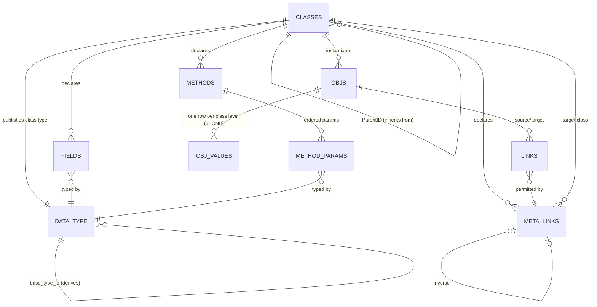

# Meta object model

Status: **implemented** in PostgreSQL and Python (PRs [#28](https://github.com/Goliath-Research/GoliathApp/pull/28)–[#33](https://github.com/Goliath-Research/GoliathApp/pull/33)). Design approved by David Izada Rodriguez ([PR #25](https://github.com/Goliath-Research/GoliathApp/pull/25)); decisions D1–D7 in §10. Apply order: [schema-apply.md](schema-apply.md) (`meta_model_phase_a.sql` … `meta_model_semantic.sql` after `meta_api_parity.sql`).

## 1. Implementation overview

| Layer | What ships | Source |
| --- | --- | --- |
| Class hierarchy | `ParentID` FK, cycle rejection, `IsAbstract`, `AncestorPath`, `Depth`, `ClassClosure`, refresh triggers | `meta_model_phase_a.sql` |
| Members | `Fields`, `Methods`, `MethodParams`, `MetaLinks`; resolved fields view; instance link triggers (`MetaLinkID`, Max/MinCard, inverse) | `meta_model_phase_a.sql` |
| Values | `"Meta"."ObjValues"` JSONB per inheritance level; `"Meta".sp_obj_insert` / `sp_obj_update`; legacy typed-table path when no `Fields` are declared | `meta_model_phase_a.sql`, `meta_model_phase_c.sql`, `meta_model_phase_e.sql` |
| Catalog types | `wf.data_type.description`, `base_type_id`, `class_id`; `fn_class_json_schema`, bundled schemas, MAJOR/MINOR publish (`sp_meta_publish_class_type`), method parameter types (`fn_method_params_json_schema`) | `meta_model_phase_a.sql`, `meta_model_phase_b.sql` |
| Views | Polymorphic `"Meta"."V<Class>"` views; immediate regeneration (`sp_class_regenerate_views`) on class/field changes | `meta_model_phase_b.sql`, `meta_api_parity.sql` (`spclassadded`, `spclasscreateviewsql`) |
| Validation | Always-on unknown/required key check on `ObjValues`; optional `pg_jsonschema` trigger via `PgValidate` / `goliath.meta_pg_validate`; flattened-schema fallback | `meta_model_phase_c.sql`, `meta_model_phase_d.sql` |
| Python | Pydantic models from class schema (`goliath_app/meta/validation.py`); semantic export uses Meta catalog types for `meta_class_name` entities | `meta_model_phase_d.sql`, `goliath_app/semantic/export.py`, `meta_bridge.py` |
| Parity APIs | `Meta.spinsertobject` / `spupdateobject` route through ObjValues when the class (or an ancestor) has `Fields` | `meta_model_phase_e.sql` |
| Semantic / actions | `Meta.sp_semantic_sync_class_entity`, `wf.wf_repo_bind_action_data_types`; FK from `portal.semantic_entity.meta_class_id` | `meta_model_semantic.sql` |
| Trees | Catalog types `meta/Tree` and `meta/TreeRef`; `"Meta"."TreeNodes"` + GiST on `Path`; path maintenance triggers | `meta_model_phase_c.sql`, `meta_model_tree_maintenance.sql` |
| Portal nav | Platform `portal/NavNode` + `Parent` hierarchical link; `NavTree.MetaObjID` bridge | `portal_nav_meta.sql`, [nav-tree-meta.md](nav-tree-meta.md) |
| Tests | pgTAP + pytest for hierarchy, schema, views, validation, fixtures | `workflow_engine/tests/test_meta_model_*.py`, `workflow_engine/sql_pg/tap/` |

**Follow-ups** (designed but not fully built) are listed in §11.

## 2. Model



### 2.1 Single inheritance

`ParentID` means strictly *inherits from*. Trees of objects no longer use it (see §6).

```sql
ALTER TABLE "Meta"."Classes"
  ADD COLUMN "IsAbstract" boolean NOT NULL DEFAULT false,
  ADD COLUMN "AncestorPath" int[] NOT NULL DEFAULT '{}',   -- root..parent, cached
  ADD COLUMN "Depth" int NOT NULL DEFAULT 0,
  ADD COLUMN "TypeID" bigint NULL REFERENCES wf.data_type(id),  -- published class type
  ADD CONSTRAINT "FK_Classes_Parent" FOREIGN KEY ("ParentID") REFERENCES "Meta"."Classes"("ID"),
  ADD CONSTRAINT "CK_Classes_NotSelf" CHECK ("ParentID" IS DISTINCT FROM "ID");

CREATE TABLE "Meta"."ClassClosure" (          -- ancestor/descendant pairs, incl. self (depth 0)
  "AncestorID" int REFERENCES "Meta"."Classes" ON DELETE CASCADE,
  "DescendantID" int REFERENCES "Meta"."Classes" ON DELETE CASCADE,
  "Depth" int NOT NULL,
  PRIMARY KEY ("AncestorID","DescendantID"));

-- BEFORE INSERT/UPDATE OF "ParentID": reject if NEW."ID" = ANY(parent.AncestorPath || parent.ID);
-- AFTER: recompute AncestorPath/Depth/closure for NEW and all descendants, then regenerate views (§5).
CREATE FUNCTION "Meta".trg_classes_hierarchy() RETURNS trigger ...;
```

Rules:
- One parent. Abstract classes cannot be instantiated (`Objs` insert trigger checks `IsAbstract`).
- Members (methods, fields, meta links) are resolved **by name, nearest definition wins** (lowest `Depth` in the closure).
- Field and meta-link overrides may only **narrow** (method signatures follow §2.3): a field's type must be the same as, or derived from (§4.1), the inherited type; `Required` may go false→true, not back; a meta link may narrow target class to a descendant and cardinality (e.g. `0..*` → `0..1`), never widen. Violations are rejected by the `Fields`/`MetaLinks` triggers.
- Re-parenting a class with existing objects is rejected unless the new chain is a superset (only adds ancestors with no required fields).

Resolution view:

```sql
CREATE VIEW "Meta"."VClassFieldsResolved" AS
SELECT DISTINCT ON (cc."DescendantID", f."Name")
  cc."DescendantID" AS "ClassID", f.*, cc."Depth" AS "DefinedAtDepth"
FROM "Meta"."ClassClosure" cc JOIN "Meta"."Fields" f ON f."ClassID" = cc."AncestorID"
ORDER BY cc."DescendantID", f."Name", cc."Depth";
```

### 2.2 Fields

```sql
CREATE TABLE "Meta"."Fields" (
  "ID" int GENERATED ALWAYS AS IDENTITY PRIMARY KEY,
  "ClassID" int NOT NULL REFERENCES "Meta"."Classes" ON DELETE CASCADE,
  "Name" text NOT NULL,
  "TypeID" bigint NOT NULL REFERENCES wf.data_type(id),
  "Required" boolean NOT NULL DEFAULT false,
  "IsHot" boolean NOT NULL DEFAULT false,      -- becomes a generated column (§4)
  "Description" text,
  UNIQUE ("ClassID","Name"));
```

### 2.3 Methods

Methods are declared in Meta. Like fields, they're inherited and overridden by name.

```sql
CREATE TABLE "Meta"."Methods" (
  "ID" int GENERATED ALWAYS AS IDENTITY PRIMARY KEY,
  "ClassID" int NOT NULL REFERENCES "Meta"."Classes" ON DELETE CASCADE,
  "Name" text NOT NULL,
  "Description" text,
  "ReturnTypeID" bigint NULL REFERENCES wf.data_type(id),   -- NULL = void
  "IsAbstract" boolean NOT NULL DEFAULT false,              -- no implementation; class must be abstract
  "IsOverride" boolean NOT NULL DEFAULT false,              -- must match an inherited method
  "IsFinal" boolean NOT NULL DEFAULT false,                 -- cannot be overridden
  "ImplKind" text NULL CHECK ("ImplKind" IN ('sql','action','python')),
  "ImplRef" text NULL,     -- proc regprocedure text | wf action name/version | python dotted path
  UNIQUE ("ClassID","Name"),
  CHECK ("IsAbstract" = ("ImplKind" IS NULL)));

CREATE TABLE "Meta"."MethodParams" (
  "MethodID" int NOT NULL REFERENCES "Meta"."Methods" ON DELETE CASCADE,
  "Ordinal" int NOT NULL,
  "Name" text NOT NULL,
  "TypeID" bigint NOT NULL REFERENCES wf.data_type(id),
  "Required" boolean NOT NULL DEFAULT true,
  "DefaultValue" jsonb NULL,          -- validated against the param type
  PRIMARY KEY ("MethodID","Ordinal"), UNIQUE ("MethodID","Name"));
```

Rules:
- **Resolution:** nearest definition wins (through `ClassClosure`), the same as for fields. Method rows are stored in `"Meta"."Methods"`; a `VClassMethodsResolved` view is **not** shipped yet (§11).
- **Abstract methods:** a concrete class must resolve every abstract method to a concrete one; this is checked when `IsAbstract` is set to false and when objects are inserted.
- **Signature compatibility on override** (parameter types invariant, return type narrows):
  - Same parameter names, in the same order.
  - An override can't add a new required parameter; it may add an optional one at the end.
  - A parameter's type must be the same as the inherited one. Changing it in either direction would break calls made through the parent's signature, so input types are invariant.
  - An optional parameter can't become required; a required one may become optional (accepts every call the parent accepted).
  - The return type may narrow to a derived type (covariant).
  - `IsOverride` must be true exactly when an inherited method exists, and a `IsFinal` method can't be overridden.
- **Implementation mapping:**
  - `sql`: a stored proc taking `(self_id int, args jsonb)`.
  - `action`: a `wf.workflow_action` whose `input_type_id` is the method's parameter type (below).
  - `python`: a handler registered in the semantic/action registry.
  - **`Meta.sp_invoke(obj_id, method, args jsonb)`** (dispatch after parameter validation) is **not** implemented yet; parameter schemas and catalog types are published for ActionSpec binding (§11).
- **Parameter schema:** `Meta.fn_method_params_json_schema(method_id)` builds a draft 2020-12 object schema from `MethodParams`: each parameter's type is a `$ref`, `required` and `default` come from the table, and `unevaluatedProperties: false`. It's published as a catalog type (`<Class>.<Method>.Params`) so ActionSpecs and the portal use it directly. The return type is already a catalog type.

## 3. Meta links vs instance links

- **Meta link**: declared on a class — name, target class, cardinality, optional inverse, `IsHierarchical`.
- **Instance link**: a real edge between two `Objs`; it must reference a meta link that is resolved for the source object's class and whose target class is an ancestor-or-self of the target object's class.

```sql
CREATE TABLE "Meta"."MetaLinks" (
  "ID" int GENERATED ALWAYS AS IDENTITY PRIMARY KEY,
  "ClassID" int NOT NULL REFERENCES "Meta"."Classes",
  "Name" text NOT NULL,
  "TargetClassID" int NOT NULL REFERENCES "Meta"."Classes",
  "MinCard" int NOT NULL DEFAULT 0,
  "MaxCard" int NULL,                         -- NULL = unbounded
  "InverseID" int NULL REFERENCES "Meta"."MetaLinks",
  "IsHierarchical" boolean NOT NULL DEFAULT false,
  UNIQUE ("ClassID","Name"));

-- existing "Meta"."Links" gains:
ALTER TABLE "Meta"."Links" ADD COLUMN "MetaLinkID" int NOT NULL REFERENCES "Meta"."MetaLinks";
-- trigger: permitted-by check, MaxCard check, inverse row maintenance.
```

`MinCard` is checked by a deferred constraint trigger at commit.

## 4. Catalog data types, JSON Schema and JSONB values

### 4.1 One catalog: extend `wf.data_type`

Don't create a second type table. Add to `wf.data_type`:

```sql
ALTER TABLE wf.data_type
  ADD COLUMN description text,
  ADD COLUMN base_type_id bigint NULL REFERENCES wf.data_type(id),  -- derivation
  ADD COLUMN class_id int NULL REFERENCES "Meta"."Classes"("ID"); -- set for class-published types
```

`schema_json` holds the type's **own fragment**. The effective schema is `{"allOf":[base_effective, own_fragment]}`. Example: `Percent` = base `Decimal` (`{"type":"number"}`) + `{"minimum":0,"maximum":100}`. "Narrowing" (§2.1) means "the overriding type is the same type or a descendant through `base_type_id`".

### 4.2 Generated class schema

`"Meta".fn_class_json_schema(class_id)` returns:

```json
{
  "$schema": "https://json-schema.org/draft/2020-12/schema",
  "$id": "goliath:meta/class/Sample",
  "allOf": [ { "$ref": "goliath:meta/class/Specimen" } ],
  "type": "object",
  "properties": { "Barcode": { "$ref": "goliath:type/Barcode" } },
  "required": ["Barcode"],
  "unevaluatedProperties": false
}
```

- **Draft 2020-12**, because with `allOf` composition only `unevaluatedProperties: false` rejects unknown keys while still seeing the parent's properties (`additionalProperties` can't). Draft 2020-12 is also what Pydantic v2 `model_json_schema` emits (`semantic/export.py`), so semantic entities and Meta classes use the same dialect.
- For validation the function also gives a **bundled** form (with `$defs` inlined) because the validator can't fetch `$ref` URIs.
- The schema is stored in the class's `wf.data_type.schema_json` (kind `object`, `class_id` set). It's regenerated when any class, field or ancestor changes, and versioned per §4.5.

### 4.3 Storage: JSONB per class level

```sql
CREATE TABLE "Meta"."ObjValues" (
  "ObjID" int NOT NULL REFERENCES "Meta"."Objs" ON DELETE CASCADE,
  "ClassID" int NOT NULL REFERENCES "Meta"."Classes",   -- the level that declares these fields
  "Data" jsonb NOT NULL DEFAULT '{}',
  PRIMARY KEY ("ObjID","ClassID"));
```

Each object has one row per class in its chain (root to leaf). The keys in a row are the fields declared at that level (a key moves to the overriding level). One unpartitioned table (Decision D3). Indexes: PK B-tree `(ObjID, ClassID)` plus B-tree `(ClassID)`; GIN `jsonb_path_ops` on `Data`. The `"IsHot"` flag on `"Meta"."Fields"` is stored today; **generated STORED columns** on `ObjValues` for hot fields are not created yet—class views project hot values with `(v."Data"->>'Field')` (§11).

### 4.4 Validation (layered, Decisions D4 and D7)

The single generated class schema (§4.2, stored in `wf.data_type.schema_json`) is the **only** source for every layer, so they can't drift. No layer writes its own rules.

1. **UI (primary, interactive):** the portal validates captured values against the class or method-parameter schema before calling the input.
2. **Python (primary, programmatic):** Pydantic models are generated from the same schema (e.g. with `datamodel-code-generator`, at build time or cached by `content_hash`) and validate every payload before it reaches Postgres. External callers always send schema-compliant JSON.
3. **Postgres (backstop, mainly for internal writers). This is a mandatory deliverable of the Meta implementation (D7), not an experiment:**
   - **Always on, cheap SQL check:** `Meta.sp_obj_insert` / `sp_obj_update` split the document by level through `VClassFieldsResolved`. They **raise on unknown keys** and on missing required keys (replacing the legacy typed-table path that silently dropped unknown JSON keys). The same check runs as a `BEFORE INSERT OR UPDATE` trigger on `ObjValues` (`TR_ObjValues_KeyCheck`). Required keys are enforced in that trigger (not deferred). Plain SQL with no extension; also the fallback when `pg_jsonschema` is absent.
   - **Full-schema trigger (shipped; toggled on or off per D4):** a `BEFORE INSERT OR UPDATE` trigger on `ObjValues` validates the merged document against the bundled schema with `jsonb_matches_schema`. It's controlled per class and per environment:

```sql
ALTER TABLE "Meta"."Classes" ADD COLUMN "PgValidate" boolean NULL;  -- NULL = follow environment
-- environment default: ALTER DATABASE ... SET goliath.meta_pg_validate = 'on'   (dev/test)
-- internal writers:    SET LOCAL goliath.meta_pg_validate = 'on' or a role-level setting
-- trigger runs when COALESCE(cls."PgValidate", current_setting('goliath.meta_pg_validate', true)::bool, false)
```

   - Suggested defaults: on in dev/test/CI and for internal roles (migrations, workers, admin SQL); off in prod for the external API path, which Pydantic has already validated.
- **Engine (preferred):** Neon `pg_jsonschema`. On 2026-11-04 Neon's extension list showed 0.3.3 on PG14–17 and 0.3.4 on PG18 (https://neon.com/docs/extensions/pg-extensions). Alternatives rejected: plv8 (Neon blocks new installs) and a full PL/pgSQL validator (too much to build).
- **Fallback (always ships):**
  - The always-on stored procedure / SQL check rejects unknown keys and enforces required keys whether or not `pg_jsonschema` is installed. Postgres validation is real even without `unevaluatedProperties`.
  - If `pg_jsonschema` is installed but `unevaluatedProperties` doesn't work, the full trigger validates a **flattened** variant (all resolved properties merged, `additionalProperties: false`, no `allOf`) generated from the same source.
  - If the extension isn't installed at all, the full trigger falls back to the SQL check plus per-key type checks for the catalog base kinds.
- **Capability probe:** runtime code in `trg_objvalues_pg_jsonschema` tries bundled `allOf` validation first and falls back to `fn_class_json_schema_flattened` when the extension is missing or `allOf` fails. A dedicated `Meta.fn_jsonschema_capabilities()` migration helper is **not** shipped yet (§11).

### 4.5 Class type versioning (Decision D6)

Each class's published catalog type (`wf.data_type`, unique on `name, version`) is versioned `MAJOR.MINOR`. Each regeneration compares the new effective schema with the last published one. If the schema didn't change, nothing is published. If it did, a new row is published with a bumped version:

- **Major** (`N+1.0`) when the effective schema (including inherited parts) does any of the following:
  - a property is added, removed or renamed;
  - a requiredness change breaks callers (optional → required; a newly required property);
  - inheritance changes (a new parent, an ancestor added or removed) alter the published schema.
- **Minor** (`N.M+1`) when an existing property changes without adding or removing properties:
  - its type is replaced, or its constraints are tightened or widened;
  - the schema fragment changes in another localized way (for example a description change that alters the fragment);
  - required → optional, which doesn't break callers.
- An ancestor change is applied to every descendant's type: each one is regenerated and bumped by the same rule.
- Method parameter types (`<Class>.<Method>.Params`) follow the same major/minor rules when a method signature changes. Return types are ordinary catalog types and are versioned as types.
- `content_hash` (the hash of the bundled schema) still drives cache invalidation of generated Pydantic models and UI validators. The version number is for humans and for compatibility checks.
- Earlier versions stay `published` until retired, so ActionSpecs pinned to an older version keep resolving.

## 5. Recursive class views

`"Meta"."V<Class>"` = parent class view + this level's fields:

```sql
CREATE OR REPLACE VIEW "Meta"."VSample" AS
SELECT p.*, (v."Data"->>'Barcode')::text AS "Barcode"
FROM "Meta"."VSpecimen" p
JOIN "Meta"."ObjValues" v ON v."ObjID" = p."ID" AND v."ClassID" = 12;
-- root view selects from "Meta"."Objs" o WHERE o."ClassID" IN (descendants of root)
```

- A view for class C includes objects of every descendant class (polymorphic select), because the root view filters through `ClassClosure`.
- `"Meta".sp_class_regenerate_views(class_id)` (re)creates views top-down for the class subtree. It runs **immediately** from `Classes`/`Fields` triggers (Decision D5). The class schema and catalog type (§4.2, §4.5) are regenerated in the same step. Legacy parity names `spclasscreateviewsql` and `spclassadded` call into it; `spclasscreatetablesql` returns a no-op comment (ObjValues replaces per-class tables).
- History: per-class history DDL is still a stub (`spclasscreatehistorysql`); a unified `"Meta"."ObjValuesHistory"` table is **not** implemented yet (§11). `HasHistory` on `"Meta"."Classes"` is unchanged; legacy typed-table history paths still apply where ObjValues is not used.

## 6. Trees

`ParentID` on `Classes` is inheritance only. For object trees:

- Declare a meta link with `IsHierarchical = true` (self or ancestor target, `MaxCard=1` toward the parent).
- Catalog types **`meta/Tree`** and **`meta/TreeRef`** are published in `wf.data_type`. `"Meta"."TreeNodes"(ObjID, MetaLinkID, Path ltree)` exists with a GiST index on `Path`. **Triggers that maintain `Path` on hierarchical link changes** (cycle rejection, subtree rewrite) are **not** shipped yet (§11).
- **`TreeRef`** field-level integrity triggers remain follow-up work (`Meta.fn_tree_ref_validate` is available for callers).
- Path maintenance for hierarchical links ships in `meta_model_tree_maintenance.sql`.
- **`portal."NavTree"`** remains for RBAC compatibility; new nodes are backed by Meta `portal/NavNode` + `TreeNodes` ([nav-tree-meta.md](nav-tree-meta.md)).

## 7. Integration

- **Semantic layer**: entities with `meta_class_name` / `meta_class_id` read `"Meta"."V<Class>"` views. `goliath_app/semantic/export.py` and `meta_bridge.py` publish `$ref` to `goliath:meta/class/{Name}` and the catalog type `meta/class/{Name}` instead of a separate Pydantic-derived row schema. `"Meta".sp_semantic_sync_class_entity` registers a class into `portal.semantic_entity` after publishing its type and view.
- **Actions**: `wf.workflow_action.input_type_id` / `output_type_id` reference `wf.data_type`. Class and method parameter types live in the same table; `wf.wf_repo_bind_action_data_types` binds an action to catalog type names/versions.
- **Exograph / portal**: curated reads can target Meta views and the semantic registry. **Generating** the Exograph model (`deploy/targets/goliath-exo*.json`) entirely from the catalog is still manual / follow-up (§11).

## 8. Legacy compatibility

Greenfield classes declare `"Meta"."Fields"` and store values in `"Meta"."ObjValues"`. Existing deployments may still have per-class typed tables from `meta_schema.sql`:

- `"Meta".spinsertobject` / `spupdateobject` (`meta_model_phase_e.sql`) call `sp_obj_insert` / `sp_obj_update` when the target class or any ancestor has `Fields`; otherwise they use the legacy typed-table implementations.
- Automated **backfill** from typed tables into `ObjValues` (report mode, compatibility views, dropping old tables) is **not** part of the shipped apply scripts—plan that per installation (§11).
- Decision D1 stands: `Classes.ParentID` is inheritance only; portal navigation uses Meta hierarchical links, with legacy `NavTree` for RBAC IDs ([nav-tree-meta.md](nav-tree-meta.md)).

## 9. Tests

pgTAP (Neon) plus pytest in this repository:
- Inheritance: FK; cycle rejection (self, 2-cycle, deep); abstract instantiation rejected; closure/path correct after re-parenting.
- Overrides: narrowing accepted, widening rejected (type, Required, link target, cardinality); nearest-wins resolution.
- Links: instance link without a permitting meta link rejected; Max/MinCard; inverse maintenance.
- Schema: golden-file `fn_class_json_schema` output; `allOf` chain; unknown key rejected; derived type bounds (Percent 101 rejected).
- Storage: per-level split; direct DML with an unknown key caught by the always-on key-check trigger.
- Views (D5): polymorphic select; a view is regenerated immediately (same transaction) after a field is added, a type changes, a class is re-parented, or an ancestor changes; descendants are refreshed too.
- Versioning (D6): golden cases for each major/minor rule (add/remove/rename, optional→required, re-parent → major; type/constraint change, required→optional → minor; no change → no new version); method signature change bumps the params type; `content_hash` changes whenever the schema changes.
- Trees: `TreeNodes` table and catalog types; path maintenance and TreeRef integrity tests are follow-up (§11).
- Legacy typed tables: round-trip where `spinsertobject` still uses the legacy path.
- Cross-layer parity: fixture corpus in `test_meta_model_fixtures.py` (Pydantic + `sp_obj_insert`); UI validator parity is out of tree here.
- Toggle: trigger fires or skips according to `PgValidate` and `goliath.meta_pg_validate`; the SQL key check always fires.
- Postgres validation (D7): tests cover key check, optional `pg_jsonschema` trigger, and flattened fallback where the extension is absent.

## 10. Decisions (David)

- **D1 (was Q5):** No existing `ParentID` rows are trees; `ParentID` is inheritance only. Portal navigation is backed by Meta `portal/NavNode` + `TreeNodes` with a `NavTree` compatibility bridge (§6, [nav-tree-meta.md](nav-tree-meta.md)).
- **D2 (was Q3):** Methods are declared in Meta (`Meta.Methods` + `Meta.MethodParams`, §2.3), inherited and overridable by name, with signature-compatibility rules. Each method is implemented by a SQL proc, an ActionSpec or a Python handler, and generates a JSON Schema for its parameters.
- **D3 (was Q1):** Values stay in the single JSONB table `Meta.ObjValues`, not partitioned by root class. Indexes: B-tree on `(ObjID, ClassID)` and `(ClassID)`, GIN on `Data`. Generated STORED columns for hot fields are follow-up (§11).
- **D4:** Primary validation happens before Postgres: Pydantic models generated from the class schema (Python) and UI validation of captured values. Postgres validation is a backstop, mainly for internal writers. An always-on SQL unknown/required-key check, plus an optional `pg_jsonschema` trigger toggled per class (`PgValidate`) and per environment (`goliath.meta_pg_validate`). All layers use the single generated schema (§4.4). Parameter types in method overrides stay strictly invariant (§2.3), as approved.
- **D5:** Each class view is regenerated **immediately** whenever the class or an ancestor that affects it changes. No deferred or queue-until-commit option (§5).
- **D6:** Class catalog types are versioned `MAJOR.MINOR` and bumped only when the schema changes. Major: a property is added, removed or renamed, a requiredness change breaks callers, or an inheritance change alters the published schema. Minor: an existing property's type or constraints change, or another localized change to the fragment. Method parameter types follow the same rules. `content_hash` still drives Pydantic and UI cache invalidation (§4.5).
- **D7:** Postgres JSON Schema validation is a mandatory deliverable. Preferred: Neon `pg_jsonschema`, with a capability probe for `unevaluatedProperties` (`allOf` mode if it works, flattened schema if not). The stored procedure / SQL required-key and unknown-key check always ships, so validation is real without the extension. The layered model and toggles from D4 are unchanged (§4.4).

## 11. Follow-ups

| Item | Notes |
| --- | --- |
| `Meta.sp_invoke` | Method dispatch after parameter validation |
| `VClassMethodsResolved` | Nearest-wins view for methods (fields already have `VClassFieldsResolved`) |
| Field/method override narrowing triggers | Rules in §2.1–§2.3; not all enforcement triggers are present |
| `ObjValuesHistory` | Replace per-class history DDL; unify with `HasHistory` |
| Hot-field generated columns | `IsHot` → STORED columns + partial indexes on `ObjValues` |
| TreeRef integrity on field values | Validate `meta/TreeRef` in ObjValues when used as field types |
| Bulk typed-table → ObjValues migration | Operational tooling for existing class tables |
| `fn_jsonschema_capabilities()` | Formal migration-time probe (runtime fallback exists today) |
| Exograph model generation | Single catalog-driven `.exo` generation |
| `spclassdelete` | Still recurses children without deleting class rows (legacy parity) |
