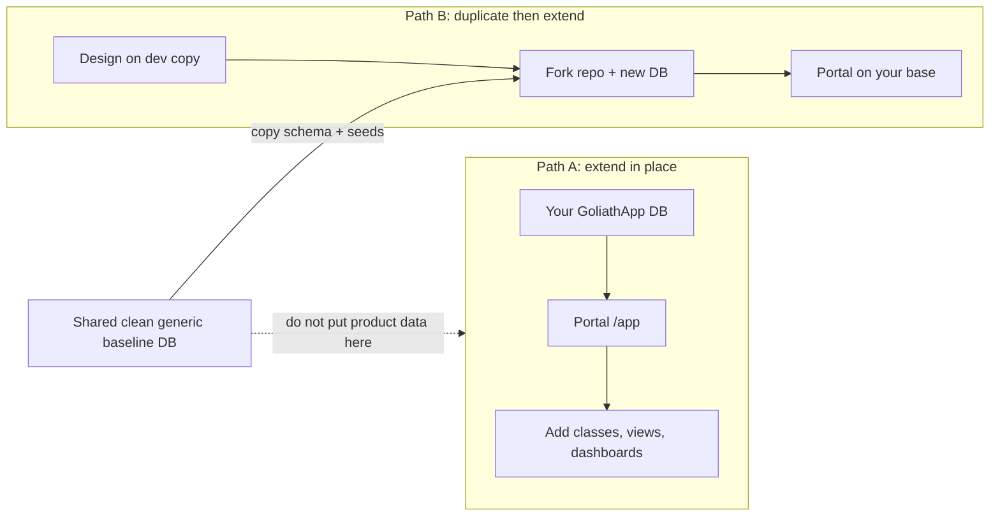

# Operator portal guide (end users)

This guide is for **operators and application owners** who sign in to the GoliathApp **platform host** (`apps/platform-host`) at `/app`. It explains how to grow your application using the signed-in portal, and how that relates to the two supported **starting paths** for any GoliathApp-based product.

Engineers implementing SQL, workers, and packaging should still read the [Adopter guide](adopter-guide.md). This page is written for people who work in the UI: classes, entities, views, and dashboards.

## What you see after sign-in

After Microsoft (or another registered) sign-in, you land in the **operator portal**:

| Area | What it is |
|------|------------|
| **Navigate (left)** | Official **NavTree** from `portal.sp_session_operator_nav_tree` — permission-filtered, nested, clickable (`node_path` routes). |
| **Main workspace** | Depends on the node you opened (see below). |
| **Header / footer** | Your name and email, sign out, active organization **scope**, and the **active role** for this session. |

### One role per session

A person may hold **multiple role grants** in an organization scope, but each portal session acts as **exactly one** selected role:

- **One grant** — the platform auto-selects that role when the session opens.
- **Several grants** — you choose a role on `/app/onboarding/select-role` before the NavTree loads.
- **No grants** — you see **No role assigned** (`/app/onboarding/no-role`) instead of an empty menu.

The active role is stored **server-side** in `RBAC.Session_Roles` via `portal.sp_session_set_active_role` (the host never trusts a browser-supplied role without verifying an active scoped grant). NavTree, semantic permissions, Meta class/object checks, and layered security evaluate **only that role**, not the union of all grants.

Use **Switch role** in the header to open the picker again; role changes are written to `portal.session_active_role_audit`.

The default home (`/app`) foregrounds the **Meta class hierarchy**: inherited GoliathApp classes plus any **semantic** classes your application added. Selecting a class opens the **Meta workbench** (class lineage, fields, **SchemaPropertyGrid**, nested property inspector, instance create/update when permitted).

Other NavTree sections (Administration, Workflows, Semantic layer, Configuration, Operations, Inventory, **Views & dashboards**) open **list screens**, **semantic views**, or **Meta** where the platform already has APIs. The same entities appear in **editors**, **list views**, and **dashboard widgets** — not separate products.

Public routes `/`, `/login`, and `/fixture` stay outside this shell; they are not the signed-in operator experience.

## Two starting paths (choose deliberately)

Every GoliathApp deployment should follow **one** of these patterns. Mixing product-specific evolution into the **shared clean baseline** database breaks the platform contract.

### Path A — Start from GoliathApp and extend in place

**When to use:** You already run (or will run) a GoliathApp database and portal host for **your** organization. You add **your** semantic namespaces, Meta classes, objects, NavTree nodes, views, and dashboards **on your deployment**, not on a communal “generic” reference database.

| Step | What you do | Where in the portal |
|------|-------------|---------------------|
| 1 | Sign in; confirm scope and NavTree | `/app` |
| 2 | Explore **inherited** platform classes | **Meta model** → hierarchy on `/app`, or **Classes** |
| 3 | Inspect or edit schema and instances | Open a class → Meta workbench + property grid |
| 4 | Register **your** semantic entities and map to Meta | **Semantic layer** (`/app/semantic`) — browse, register namespaces/entities/attributes; session APIs wrap the registry — see [Platform generic Meta](platform-generic-meta.md) |
| 5 | **Define views** on entities you care about | **Views** (`/app/views/list`) — save a view on a semantic request or Meta class |
| 6 | **Arrange dashboards** from saved views | **Dashboards** (`/app/views/dashboards`) |
| 7 | Subclass platform parents, add fields, NavTree, grants | **Meta** home authoring panel; **Administration → Navigation** for nodes and role grants; **Export as package SQL** for child repos — see [NavTree on Meta](nav-tree-meta.md) |
| 8 | Users, roles, class/object security | **Administration → Users** (sign-in status, invitations, scoped roles); **Roles**; Meta **Security** tab; [Layered security model](platform-layered-security.md) |

**Users workflow:** Create the person with their work email (no password — Entra/OIDC only). Grant a **scoped role** so NavTree and permissions apply; the table flags **None — grant role** until then. **Awaiting first … sign-in** means they should use **Copy sign-in link** and authenticate with the org provider; invitations are fulfilled on that first login when the verified email matches.

**Database rule:** Product and domain data for Path A live on **your** PostgreSQL instance (or your Neon branch / dedicated database). The official GoliathApp **reference** database used only to ship the platform stays a **clean generic baseline** — do not use it as your production tenant store.

### Path B — Define first, then duplicate GoliathApp as your base

**When to use:** You want a **fork or copy** of the platform (schema + seeds + host) as **your** application repository and database, then add everything you designed.

| Step | What you do | Notes |
|------|-------------|--------|
| 1 | Design Meta classes, semantic entities, workflows, and NavTree **on paper or in a dev copy** | Use a **throwaway** or team database, not the shared clean baseline |
| 2 | **Duplicate** GoliathApp: new repo fork or new DB from `apply_schema.sh` + platform seeds | See [Database population](database-population.md), [Schema apply](schema-apply.md) |
| 3 | Apply **your** SQL seeds (semantic namespace, Meta classes, actions, nav) | Layer 4 in population guide |
| 4 | Deploy **your** platform host (same packages, your `GoliathUiManifest`) | [Platform UI host](deploy/platform-host.md) |
| 5 | Sign in to **your** host `/app` and operate as in Path A | Views/dashboards stored per **scope** in `portal.operator_view` / `portal.operator_dashboard` |

**Database rule:** After duplication, **all** product work happens on the **copy** or **child database**. The upstream GoliathApp generic baseline remains unchanged for other adopters.



## Working with the class hierarchy (primary surface)

Child applications extend GoliathApp mainly by adding **semantic classes** and the **lower-level Meta classes** underneath them.

1. Open **Meta model** or the home hierarchy.
2. Find your namespace (child classes often use a prefix such as `your_app/…`).
3. Click a class to open the **workbench** — same editors as API-backed Meta routes (`/app/meta?class=…`).
4. Use **Objects**, **Fields**, **Relations**, and related NavTree leaves when you need a focused entry; they open the same workbench with sensible defaults.

### Editing classes, fields and relations

**Meta model → Classes**, **Fields** and **Relations** are generic record editors over `Meta.Classes`, `Meta.Fields` and `Meta.MetaLinks`. They work the same for every application: a child app gets its model editable just by seeding classes, never by shipping UI code.

- **Classes:** create a class as `namespace/ClassName` under an existing parent and mark it abstract. Re-parenting is not offered. A class can be deleted only while it has no subclasses, objects, fields, methods, relations or semantic mapping.
- **Fields:** each field is typed by a catalog data type (picked, never typed). A name already used along the class's inheritance line is refused. Changing a type while objects hold values is published as a breaking schema version. A field is deleted only when no object holds a value for it.
- **Relations:** choose the target class, cardinality (empty max = unbounded) and whether it is hierarchical. A new maximum lower than what existing links already use is refused; the hierarchical flag is fixed once instances exist. A relation is deleted only when no instance uses it.
- Classes, fields and relations of `platform/…` classes can be changed only in the **God Architect** role. Every change is audited.

Semantic entities registered in the portal layer link to Meta when `meta_class_id` is set. On **Semantic layer → Entities**, open the **Meta class** link to jump into the workbench for that backing class.

### Editing the semantic layer

**Semantic layer → Namespaces, Entities, Attributes, Requests** are property-grid record editors. Every field
is typed; nothing is entered as JSON.

- **Namespaces**: create, rename, set the owner app; **Delete** only when the namespace has no entities or
  requests. The platform namespaces (`platform`, `portal`, `core`) are edited by the God Architect only.
- **Entities**: create (optionally mapped to a Meta class), edit name, description and storage relation;
  **Delete** removes an unmapped entity with no requests (its attributes go with it). The Meta class mapping
  is changed in the Meta model.
- **Attributes**: column, type, role (list, detail, filter, key) and the filter operators allowed on it
  (eq, gte, lte, starts_with, is_null). An attribute used by a request filter cannot be deleted, and an
  operator a filter uses cannot be removed.
- **Requests**: target (a function `schema.name(integer, jsonb, integer)` or a runner template, both picked
  from a list), row type (a portal composite type), permission, row cap, **parameters** as a typed list
  (name, type, required, nullable, limits) and **filters** as a list of attribute/operator/parameter
  conditions (template targets). The stored parameter schema and filter template are generated from these
  lists, and the result schema from the row type. A request whose stored schema uses features the list
  cannot express keeps it as is and its parameters are read-only here. **Retire** keeps a request but stops
  it running and listing; **Activate** restores it; **Delete** removes a retired request.

Every change requires `platform.model.author` and is recorded in `portal.record_editor_audit`.

## Record grids (every list screen)

Every list in the portal is the same **record grid**: a sortable, filterable table of records with **Add** in the toolbar and **View** / **Edit** (plus Delete, Retire, Activate or similar where the backend supports it) on each row.

- Click a column header to sort (again to reverse, a third time to clear). Type in **Filter…** to keep only rows containing every word.
- **View** and **Edit** open the record in a side drawer with the typed property grid; nested values open in the nested inspector on top. **View** is read-only and offers **Edit**. Press Escape or **Close** to return to the grid.
- The grid is driven by metadata (record-editor definitions, Meta class fields and data types, or query columns), so a child application's seeded classes and records get the same grid and drawer with no UI code.

## Tree editor (tree-shaped classes)

A class is tree-shaped when it, or an ancestor, has a **hierarchical** relation to itself (for example `portal/NavNode.Parent`). For those classes the workbench shows a **tree** instead of a flat grid. **Meta model → Trees** lists every tree-shaped class, and **Admin → Navigation & grants** opens the navigation tree.

- Expand or collapse nodes, or use **Expand all** / **Collapse all**. **Filter…** keeps matching nodes and their ancestors.
- **Add** (toolbar) creates a top-level node. **Add child** and **Add sibling** create a node in place; the drawer opens with the class's typed property grid.
- **↑ / ↓** reorder siblings. **Move…** picks a new parent (a node's own subtree is never offered). You can also drag a node onto another node to make it a child, or onto the drop zone to make it top level. Moves that would create a cycle are refused.
- **View** / **Edit** open the node in the drawer. **Delete** is offered only for leaf nodes and is refused while something still references the node (for navigation: role grants on the menu entry).
- Trees of `platform/…` and `portal/…` classes (the navigation tree included) are changed only in the **God Architect** role. Every move and delete is audited.
- The menu (`portal.NavTree`) follows the navigation tree automatically: parent, order, caption and path.

Child apps get the same editor by seeding a class with a hierarchical self relation; no UI code is needed.

## Picking existing records (reference fields)

Fields that point at an existing record are never typed by hand. A JSON Schema property
annotated with `x-goliath-ref` renders as a **reference picker**: a search box plus a list of
matching rows. Pick a row to set the value.

```json
{ "type": "string",  "x-goliath-ref": "action" }
{ "type": "integer", "x-goliath-ref": { "kind": "workflow_version" } }
```

Built-in kinds: `action`, `meta_method`, `workflow_def`, `workflow_version`, `event_type`,
`cluster` (stores the cluster key), `cluster_id` (stores the numeric id), `worker`, `data_type`,
`meta_class`, `study`. Search runs server-side through `portal.sp_session_search_references`,
which checks the session's NavTree entitlements for each kind; the Meta catalog kinds
(`meta_class`, `meta_method`, `data_type`) also require `meta.schema.read`. Pickers work at every nesting depth. Nested inspectors show the full property path
as a breadcrumb, and Escape or **Back to …** closes only the innermost inspector.

## Views and dashboards (same entities as editors)

**Views** are saved presentation definitions on top of:

- A **semantic request** (`portal.sp_run_semantic_request`) — tabular read of organizations, inventory, or your registered requests, or  
- A **Meta class** — opens the workbench for inspect/edit.

**Dashboards** compose **saved views** in your organization scope (reorder, save arrangement). Widget previews use the same semantic runner as list screens; Meta-linked views point you to the workbench for edits.

| Task | NavTree | Route |
|------|---------|--------|
| Define a new view | Views → **Views** | `/app/views/list` |
| Run a saved view | Views list | Select view → preview |
| Create a dashboard | Views → **Dashboards** | `/app/views/dashboards` |
| Arrange widgets | Dashboard editor | Add views, reorder, **Save arrangement** |

Platform-shipped semantic requests (for example `core.list_organizations`, `inv.item.list`) appear in the view catalog; your application adds more via the semantic registry ([Semantic extensions](semantic-extensions.md)).

## Administration and platform surfaces

Under **Administration**, **Workflows**, **Configuration**, **Operations**, and **Inventory**, the portal opens **read/list** surfaces backed by existing `portal.sp_session_*` wrappers where implemented. These are the same PostgreSQL APIs operators have always had through stored procedures; the host does not bypass RBAC.

If a leaf has no host screen yet, the UI states that clearly — the NavTree node remains part of the inherited menu for child apps to extend.

## What this guide does not cover

- **Worker enrollment and claims** — gateway HTTP only; see [Workers](workers.md).
- **Applying SQL migrations** — privileged roles and CI; see [Database population](database-population.md).
- **OIDC and session configuration** — [Platform host P1 auth](deploy/platform-host-p1-auth.md).

## Related documentation

| Topic | Page |
|-------|------|
| Portal implementation plan and deliverables | [Platform host operator portal (plan)](deploy/platform-host-operator-portal.md) |
| Visualization packages and phases | [Platform visualization](visualization.md) |
| Engineer adoption | [Adopter guide](adopter-guide.md) |
| NavTree and Meta bridge | [Portal nav (Meta Tree)](nav-tree-meta.md) |
| Semantic registration | [Semantic extensions](semantic-extensions.md) |

## Editing workflow records

The Workflows pages **Actions**, **Domain programs**, **Workers and clusters** and **Event subscriptions**
open a typed property-grid inspector when you choose **Edit** on a row (or **New …**). Every field is a
typed control: references to existing rows use the searchable reference picker, lists and nested objects
open nested inspectors, and no field accepts typed or pasted JSON. Saving requires the page's navigation
entitlement plus the `platform.model.author` permission, and every save is recorded in
`portal.record_editor_audit`.

- **Actions are class methods.** The Actions page lists the effective methods of each Meta class, with
  inherited methods marked *inherited from …* and overriding methods marked *override*. Editing a method
  edits the Meta method and its typed parameters (each parameter type is picked from the existing data
  types); the bound `wf.workflow_action` catalog row is synchronised on save (capability, execution
  settings, output type, and — when the method declares parameters — the published parameters type and the
  action input schema). Choose **Override here** on an inherited method to give a subclass its own
  implementation. Parameter defaults are edited in a second grid generated from each parameter's data type
  (class-backed types open the class's own grid).
- **Workflow designer** (Definitions and Steps). **Add workflow** creates the definition with an
  inactive version 1.0 that holds one root node. **Edit** opens the designer:
  - The toolbar adds a node of any type. ACTION nodes pick their action from the catalog, and a new
    node goes under the selected node.
  - **Connect** links the selected node to another node; you can also drag between nodes on the
    canvas. **Remove**, or the Delete key, removes a node with its edges and bindings.
  - Selecting an ACTION node shows **Parameters**: literal values typed by the action's class-method
    parameters, plus bindings of parameters to workflow variables or earlier step outputs. Binding
    targets are picked from the parameter names.
  - **Save as new version** stores everything as a new inactive version; **Activate** makes it
    current.
  - Saving checks the action key: an ACTION node must name a catalog action, and other node types
    must not name one.
  - Edited parameter values must be declared parameters of the action. Nodes whose parameters you did
    not edit keep their previous input templates.
- **Domain programs** edit draft metadata only; the program body is preserved, and a new version starts
  from the body of the latest version. Published versions are immutable — save under a new version, then
  **Publish**. **Program structure** below the list shows a version read-only: its variables, event
  triggers, phases and body as a tree (actions with their inputs, branches, loops, waits). When the version
  has a compiled workflow, **Open graph** opens that workflow version in **Definitions**. Structural
  changes stay in the program's seed.
- **Workers and clusters** edit cluster settings and worker enrollments (create, change IP, revoke). An
  enrolled worker's row shows its desired state; **Drain** (finish the current task, claim nothing new),
  **Stop** (cancel stoppable work at the next safe point) and **Activate** set it, and workers read it on
  their next claim or heartbeat. Machines are never started or provisioned from here. The **Worker fleet**
  page links to this screen. **Retire** marks a cluster DISABLED (kept for history); **Delete** removes a
  cluster only when it has no workers or enrollments, and removes an enrollment only once it is pending or
  revoked.
- **Event subscriptions** pick the event type and workflow version from existing records and describe the
  payload filter as a list of key/value conditions. **Retire** disables a subscription (kept); **Delete**
  removes it and keeps the recorded events.

Every fleet, retire and delete action asks for confirmation, requires `platform.model.author`, and is
recorded in `portal.record_editor_audit`.

## Editing workflow graphs and inspecting runs

**Definitions** and **Steps** list every workflow version. **Edit** opens the version graph as a read-only
canvas (laid out top to bottom from the root; nodes show their type and action or condition, edges their
branch) above the property grid (Definitions: root node, nodes, edges and bindings; Steps: nodes and edges only). Saving
never changes the version you opened: it creates a **new inactive version** of the same workflow (next
minor version). Node input templates are carried over by node key. Use **Activate** to make a version the
one new runs use; event subscriptions keep pointing at the version they reference, so repoint them in
**Event subscriptions** when needed.

The **Runs** page includes a **Run inspector**: pick a recent run to see its node executions, scope
variables and linked study. From there you can **Cancel run** (queued work is dropped), **Retry** a failed
node (it is queued again for a worker), or **Link study** by picking an existing study. These actions
require `platform.model.author` and are recorded in `portal.record_editor_audit`.
