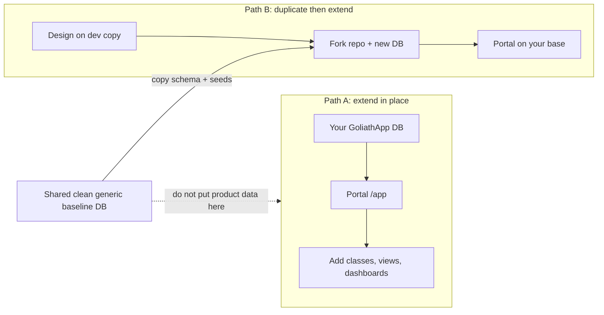

# Operator portal guide (end users)

This guide is for **operators and application owners** who sign in to the GoliathApp **platform host** (`apps/platform-host`) at `/app`. It explains how to grow your application using the signed-in portal, and how that relates to the two supported **starting paths** for any GoliathApp-based product.

Engineers implementing SQL, workers, and packaging should still read the [Adopter guide](adopter-guide.md). This page is written for people who work in the UI: classes, entities, views, and dashboards.

## What you see after sign-in

After Microsoft (or another registered) sign-in, you land in the **operator portal**:

| Area | What it is |
|------|------------|
| **Navigate (left)** | Official **NavTree** from `portal.sp_session_operator_nav_tree` — permission-filtered, nested, clickable (`node_path` routes). |
| **Main workspace** | Depends on the node you opened (see below). |
| **Header / footer** | Your name and email, sign out, active organization **scope**. |

The default home (`/app`) foregrounds the **Meta class hierarchy**: inherited GoliathApp classes plus any **semantic** classes your application added. Selecting a class opens the **Meta workbench** (class lineage, fields, **SchemaPropertyGrid**, nested property inspector, instance create/update when permitted).

Other NavTree sections (Administration, Workflows, Semantic layer, Configuration, Operations, Inventory, **Views & dashboards**) open **list screens**, **semantic views**, or **Meta** where the platform already has APIs. The same entities appear in **editors**, **list views**, and **dashboard widgets** — not separate products.

Public routes `/`, `/login`, and `/fixture` stay outside this shell; they are not the signed-in operator experience.

## Two starting paths (choose deliberately)

Every GoliathApp deployment should follow **one** of these patterns. Mixing product-specific evolution into the **shared clean baseline** database breaks the platform contract.

### Path A — Start from GoliathApp and extend in place

**When to use:** You already run (or will run) a GoliathApp database and portal host for **your** organization. You add **your** semantic namespaces, Meta classes, objects, NavTree nodes, views, and dashboards **on your deployment**, not on a communal “generic” reference database.

| Step | What you do | Where in the portal |
|------|-------------|---------------------|
| 1 | Sign in; confirm scope and NavTree | `/app` |
| 2 | Explore **inherited** platform classes | **Meta model** → hierarchy on `/app`, or **Classes** |
| 3 | Inspect or edit schema and instances | Open a class → Meta workbench + property grid |
| 4 | Register **your** semantic entities (engineering) | **Semantic layer** lists; engineering uses `portal.sp_semantic_register_*` — see [Semantic extensions](semantic-extensions.md) |
| 5 | **Define views** on entities you care about | **Views** (`/app/views/list`) — save a view on a semantic request or Meta class |
| 6 | **Arrange dashboards** from saved views | **Dashboards** (`/app/views/dashboards`) |
| 7 | Add navigation for new modules (engineering) | `portal.sp_nav_register_node` + Role2Node — see [NavTree on Meta](nav-tree-meta.md) |

**Database rule:** Product and domain data for Path A live on **your** PostgreSQL instance (or your Neon branch / dedicated database). The official GoliathApp **reference** database used only to ship the platform stays a **clean generic baseline** — do not use it as your production tenant store.

### Path B — Define first, then duplicate GoliathApp as your base

**When to use:** You want a **fork or copy** of the platform (schema + seeds + host) as **your** application repository and database, then add everything you designed.

| Step | What you do | Notes |
|------|-------------|--------|
| 1 | Design Meta classes, semantic entities, workflows, and NavTree **on paper or in a dev copy** | Use a **throwaway** or team database, not the shared clean baseline |
| 2 | **Duplicate** GoliathApp: new repo fork or new DB from `apply_schema.sh` + platform seeds | See [Database population](database-population.md), [Schema apply](schema-apply.md) |
| 3 | Apply **your** SQL seeds (semantic namespace, Meta classes, actions, nav) | Layer 4 in population guide |
| 4 | Deploy **your** platform host (same packages, your `GoliathUiManifest`) | [Platform UI host](deploy/platform-host.md) |
| 5 | Sign in to **your** host `/app` and operate as in Path A | Views/dashboards stored per **scope** in `portal.operator_view` / `portal.operator_dashboard` |

**Database rule:** After duplication, **all** product work happens on the **copy** or **child database**. The upstream GoliathApp generic baseline remains unchanged for other adopters.

## Working with the class hierarchy (primary surface)

Child applications extend GoliathApp mainly by adding **semantic classes** and the **lower-level Meta classes** underneath them.

1. Open **Meta model** or the home hierarchy.
2. Find your namespace (child classes often use a prefix such as `your_app/…`).
3. Click a class to open the **workbench** — same editors as API-backed Meta routes (`/app/meta?class=…`).
4. Use **Objects**, **Fields**, **Relations**, and related NavTree leaves when you need a focused entry; they open the same workbench with sensible defaults.

Semantic entities registered in the portal layer link to Meta when `meta_class_id` is set. On **Semantic layer → Entities**, open the **Meta class** link to jump into the workbench for that backing class.

## Views and dashboards (same entities as editors)

**Views** are saved presentation definitions on top of:

- A **semantic request** (`portal.sp_run_semantic_request`) — tabular read of organizations, inventory, or your registered requests, or  
- A **Meta class** — opens the workbench for inspect/edit.

**Dashboards** compose **saved views** in your organization scope (reorder, save arrangement). Widget previews use the same semantic runner as list screens; Meta-linked views point you to the workbench for edits.

| Task | NavTree | Route |
|------|---------|--------|
| Define a new view | Views → **Views** | `/app/views/list` |
| Run a saved view | Views list | Select view → preview |
| Create a dashboard | Views → **Dashboards** | `/app/views/dashboards` |
| Arrange widgets | Dashboard editor | Add views, reorder, **Save arrangement** |

Platform-shipped semantic requests (for example `core.list_organizations`, `inv.item.list`) appear in the view catalog; your application adds more via the semantic registry ([Semantic extensions](semantic-extensions.md)).

## Administration and platform surfaces

Under **Administration**, **Workflows**, **Configuration**, **Operations**, and **Inventory**, the portal opens **read/list** surfaces backed by existing `portal.sp_session_*` wrappers where implemented. These are the same PostgreSQL APIs operators have always had through stored procedures; the host does not bypass RBAC.

If a leaf has no host screen yet, the UI states that clearly — the NavTree node remains part of the inherited menu for child apps to extend.

## What this guide does not cover

- **Worker enrollment and claims** — gateway HTTP only; see [Workers](workers.md).
- **Applying SQL migrations** — privileged roles and CI; see [Database population](database-population.md).
- **OIDC and session configuration** — [Platform host P1 auth](deploy/platform-host-p1-auth.md).

## Related documentation

| Topic | Page |
|-------|------|
| Portal implementation plan and deliverables | [Platform host operator portal (plan)](deploy/platform-host-operator-portal.md) |
| Visualization packages and phases | [Platform visualization](visualization.md) |
| Engineer adoption | [Adopter guide](adopter-guide.md) |
| NavTree and Meta bridge | [Portal nav (Meta Tree)](nav-tree-meta.md) |
| Semantic registration | [Semantic extensions](semantic-extensions.md) |
