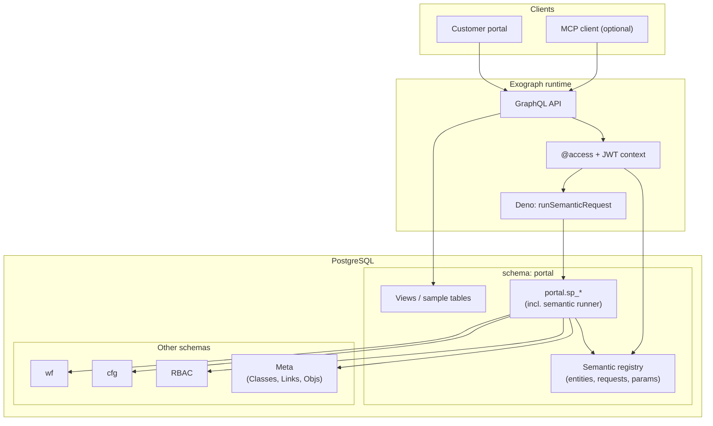
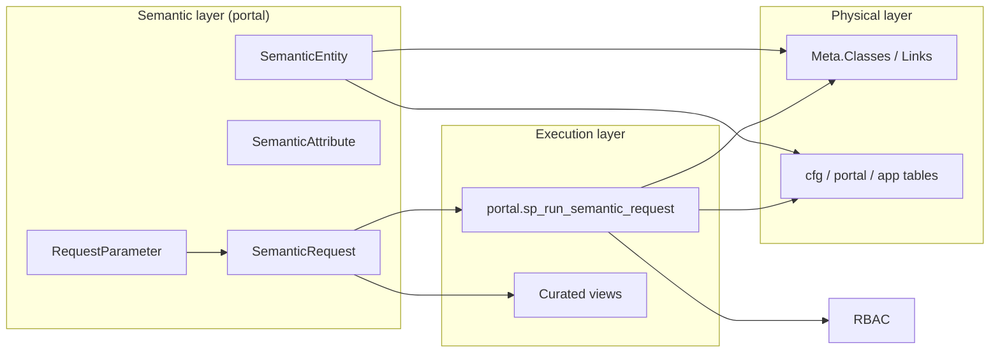
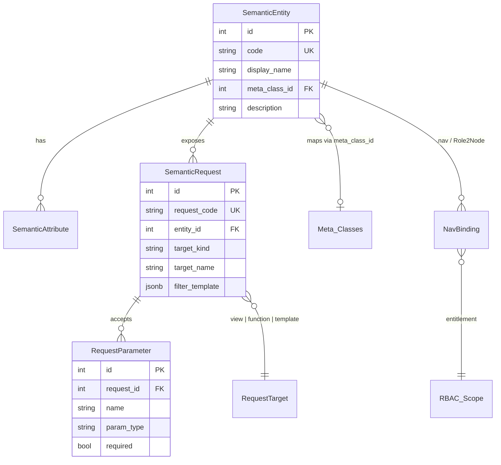
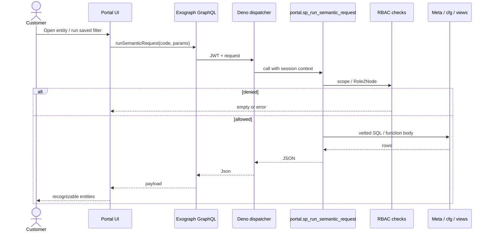
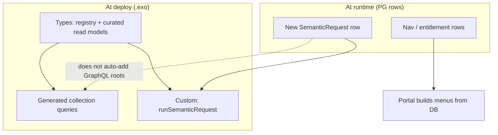
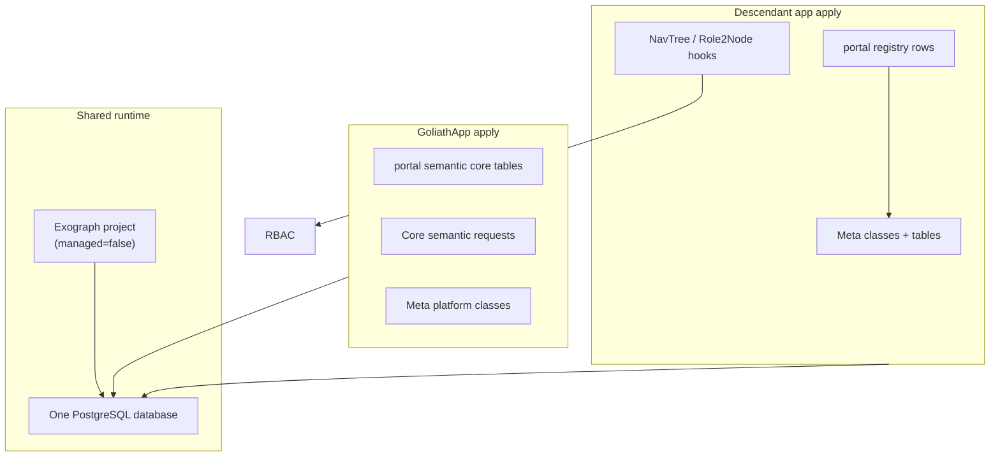
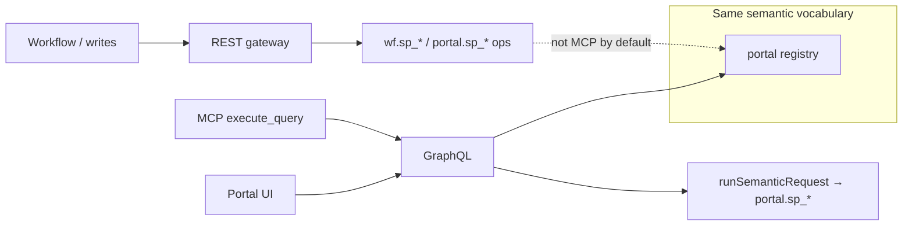

# Semantic layer

GoliathApp stores platform mechanics in PostgreSQL schemas such as `wf`, `cfg`, and `RBAC`, and exposes operator behavior through `portal.sp_*` and related functions. Domain tables and Meta-backed classes often live in the same database but are split across apply scripts and descendant applications (for example GoliathOmics).

Customers need a **stable vocabulary**—Study, Sample, Contract—not raw schema names. Agents benefit from the same vocabulary through an optional MCP channel, but most access is through a **portal** where users recognize entities and run saved queries.

This document describes a target architecture: **semantic definitions and requests live in the `portal` schema**, execution stays in **PostgreSQL** (with existing RBAC and Meta integration), and **Exograph** optional provides GraphQL and MCP as a façade—not as the sole definition store.

The database may be hosted on any PostgreSQL 15+ instance; nothing here assumes a specific cloud vendor.

## Goals

| Goal | Approach |
|------|----------|
| Semantic entities customers recognize | Registry tables in `portal` |
| Definitions in the database | Rows versioned with platform/app migrations |
| Reuse Meta, RBAC, cfg, wf | `portal` functions join cross-schema as today |
| Portal-first queries | UI loads catalog; runs vetted entry points |
| Optional MCP | Same GraphQL contract as the portal backend |
| App descendants | Core registry in GoliathApp; apps add entities and requests |
| Workflow writes | Unchanged: REST gateway → `wf.sp_*` / `portal.sp_*` ops |

## Architecture at a glance

PostgreSQL holds the **semantic catalog** and **execution logic**. Exograph is a **read/query façade** (GraphQL and optional MCP). The portal uses that contract; MCP is secondary.



## Layers of truth

| Layer | Where it lives | What customers see |
|-------|----------------|-------------------|
| Vocabulary | `portal` registry rows | Study, Sample, Run |
| Physical / class model | `Meta`, app tables | Internal mapping (optional link from registry) |
| Authorization | `RBAC` + portal checks | What they may open |
| Operations | `wf` / gateway | Starts, retries (outside semantic read layer) |



## Portal semantic registry (conceptual model)

These tables are a **design target**; they are not yet applied by scripts in this repository. Names and columns may change during implementation.



Suggested responsibilities:

- **SemanticEntity** — Stable `code`, customer-facing `display_name`, optional link to `"Meta"."Classes"` for class-backed storage.
- **SemanticAttribute** — Fields shown in list/detail/filter UI; may map to columns or computed labels.
- **SemanticRequest** — Named, versioned read operation: points to a view, a `portal.sp_*` function, or a parameterized template evaluated only inside trusted SQL.
- **RequestParameter** — Typed inputs the portal and API expose.
- **NavBinding** — Integration with navigation and entitlements (same ideas as `portal."NavTree"` and `portal."Role2Node"` referenced in [RBAC](rbac.md) and [schema apply](schema-apply.md)).

## Customer read request (sequence)



For **curated browse** (list/detail without a saved request), GraphQL may query unmanaged types mapped to views, still subject to `@access` and/or views that embed RBAC.

## Exograph’s role

Exograph maps PostgreSQL tables across **multiple schemas** using `@postgres(schema=...)` and `@table(schema=..., name=...)`. Goliath uses quoted PascalCase in `"Meta"` and lowercase in `wf`; Exograph supports explicit `@column("ID")` style mappings. Brownfield databases should use `@table(managed=false)` so Exograph does not own DDL that [schema apply](schema-apply.md) already manages.

| Mechanism | Purpose |
|-----------|---------|
| Postgres module types on `portal` registry | CRUD/discovery of definitions (admin/builder) |
| Postgres module types on curated views / tables | Typed list/filter/detail for known entities |
| Deno module `runSemanticRequest` | Dispatch by `request_code` to `portal.sp_*` |
| `@access` + JWT | Align with portal auth; **sensitive reads should still enforce RBAC inside SQL** |
| MCP `execute_query` | Optional; same GraphQL as portal BFF |

Exograph’s Postgres plugin **does not** add a new root GraphQL field for every new registry row at runtime. Dynamic behavior uses the generic **runSemanticRequest** path (or portal-only SQL called from the UI without Exograph).



Example split (illustrative only):

```exo
@postgres(managed=false)
module GoliathPortal {
  @table(schema="portal", name="semantic_entity")
  type SemanticEntity { ... }

  @table(schema="Meta", name="Classes")
  type MetaClass {
    @pk @column("ID") id: Int
    @column("Name") name: String
  }
}

@deno("semantic.ts")
module SemanticRuntime {
  query runSemanticRequest(requestCode: String, params: Json): Json
}
```

## App descendants

GoliathApp ships core registry tables and shared requests. A descendant application adds Meta classes, domain tables, registry rows, and nav bindings in its own apply scripts—without forking the execution engine.



## Channels and boundaries



- **Reads** — Semantic requests and curated entity queries.
- **Writes / workflow** — Existing gateway and procedural APIs; do not expose destructive MCP mutations by default.

## Relation to other options

| Option | Fit |
|--------|-----|
| **Exograph + portal registry (this doc)** | Portal-first, DB-backed definitions, optional MCP |
| **Apache AGE** | In-DB graph traversals; does not replace a customer entity catalog; MCP is custom |
| **`.exo` only (no registry)** | Fast bootstrap; poor fit for per-tenant/per-app requests without redeploy |
| **Meta alone** | Class/table model; lacks customer-facing request catalog and portal UX binding |

See [Platform](platform.md) for current schemas and [RBAC](rbac.md) for portal integration points.

## Implementation checklist (future)

1. Add `portal` registry DDL and `portal.sp_run_semantic_request` (or equivalent) to the PostgreSQL apply list with RBAC checks matching existing portal APIs.
2. Add curated views where ad hoc joins would otherwise leak schema complexity.
3. Introduce Exograph with `managed=false`, Deno dispatcher, and JWT aligned with portal sessions.
4. Wire portal UI to GraphQL or call the same stored procedures directly.
5. Document descendant app conventions for registering entities and requests.

## Status

This document is **architecture only**. Registry tables and the semantic runner are not part of the current `workflow_engine/sql_pg/` apply array. When implemented, update [schema apply](schema-apply.md) and [Platform](platform.md) accordingly.
