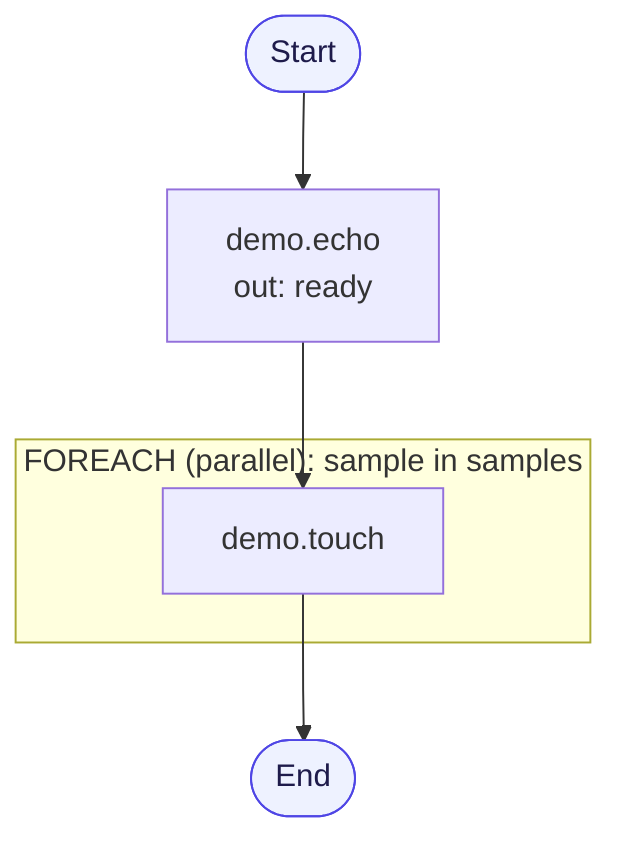

# Workflow compiler

`workflow_engine/domain/compiler.py` lowers a DomainProgram into a `WorkflowDefinitionSpec` plus a `context_json` seed. The spec is the graph the local runner and `wf.wf_repo_create_workflow_graph` consume. Models live in `workflow_engine/domain/program.py` and `workflow_engine/contract/workflow_definition_spec.py`.

```bash
goliath-workflow-run --program program.json --compile-only -o spec.json
```

`compile_domain_program` and `compile_domain_program_file` are the Python entry points. `--compile-only` calls the file compiler with context enrichment off.

## Program document

A DomainProgram is JSON:

| Field | Role |
|-------|------|
| `programVersion` | `1` uses `phases`. `2` may use a statement `body`. The compiler reads `body` when it is non-empty, and otherwise walks `phases`. |
| `name`, `description` | Copied onto the workflow spec. |
| `projectPath` | Stored on `context_json` as `projectPath`. |
| `variables` | Scalar seeds, or typed declarations (`schemaRef` or inline `schema`). Declarations become `variable_schemas` on the spec and are not copied as context values. |
| `phases` | Each phase is a sequence, or a `foreach` whose steps are the `BODY`. |
| `body` | Statement list: action, assign, if, switch, while, repeat, for/foreach, parallel, wait. |
| `on` | Event triggers (`event`, `mode`, optional `filter`) copied to `event_triggers`. Modes are `start_instance`, `signal_wait`, and `start_or_signal`. |
| `scopeDefaults` | Names of extra root-scope variables the program needs. The compiler always adds `projectPath`, then each declared name (valid identifiers only). It does not invent application names. |

Step objects:

| Step | Becomes |
|------|---------|
| `action` or `do` | `ACTION` node. `with` / `in` supply the input template. `out` maps a scope variable to a JSON path on the output (default `$.value`). |
| `assign` | `ACTION` plus an output binding. Requires `using` or `do` (the action name) and writes `fromPath` (default `$.value`) into the named variable. |
| `if` / `switch` / `while` / `repeat` | Control nodes. Conditions become scope variable names (`${var.name}` or the left side of `==`). |
| `for` or `foreach` | `FOREACH` with collection, item, index, and `foreach_parallel`. |
| `parallel` | `PARALLEL` whose children are linked with branch `PARALLEL`. |
| `wait` | `WAIT_EVENT`. The local scheduler refuses to run this node. The database engine parks it until `wf.sp_ingest_event` delivers a match. |

Node types on the spec are `ACTION`, `SEQUENCE`, `PARALLEL`, `IF`, `SWITCH`, `REPEAT`, `WHILE`, `FOREACH`, and `WAIT_EVENT`. Edges use `SEQUENCE`, `PARALLEL`, `THEN`, `ELSE`, `CASE`, `DEFAULT`, or `BODY`.

`project.*` references inside a foreach become `collection_bindings`: a `jsonFile` binding for `project` (path variable `projectPath`) and a `jsonPath` binding per field.

## Actions while compiling

`workflow_engine/domain/action_catalog.py` imports an optional product worker `action_catalog` module when that package is installed.

- When the catalog is absent, the compiler accepts any action name and takes the input template from the step (`with` / `in` / `out`).
- When the catalog is installed and the name is missing, compilation raises `ValueError`.
- When the catalog row exists, catalog template rules are applied on top of the step.

A platform-only install can compile and, with `--stub-external`, walk the graph. It cannot run product handlers.

## Verification

`workflow_engine/domain/verify_workflow.py` checks a compiled graph for a missing root, duplicate `node_key`, dangling edges, unreachable nodes, IF branches, and catalog coverage when a catalog is installed.

```bash
goliath-cfg verify-workflow --program workflow_engine/tests/fixtures/sample_prep.program.json
```

The CLI default program path is `workflow_engine/domain/fixtures/sample_prep.program.json`, which is not in this tree. Pass `--program`. `--check-db` compares compiled ACTION nodes to the active `wf.workflow_version` using the gateway connection. `--site` and `--procedure` are optional files; the CLI's built-in procedure path is also absent from this tree, and a missing file is skipped.

## Server-side compile and publish

The operator portal compiles and publishes a draft DomainProgram on the server. **Compile and publish** (`/app/workflows/domain-programs`) runs `workflow_engine/domain/compile_service.py` (`python3 -m domain.compile_service`). The host sends the program document plus the action compile profiles from `wf.action_compile_profile` (seeded by the app that owns each action). The service is generic: it knows no application; everything application-specific arrives in that input. A program that uses an action with no compile profile is refused with a message naming the action.

A successful compile creates a new **inactive** workflow version and publishes the program linked to it. Activate the version on **Workflow definitions**. Nothing is deleted. See [Operator portal guide](operator-portal-guide.md#editing-and-compiling-domain-programs).

## File-store compile

`goliath-cfg publish-program` compiles the `domain_program` document from the file store and writes `<work>/goliath/env/compiled/<name>.compiled.json`. That path is for offline or work-root workflows. The portal compile service above is the database-backed path operators use on a running platform host.

## Rendering Mermaid diagrams

`workflow_engine/domain/mermaid.py` (`python3 -m domain.mermaid` or `goliath-cfg render-mermaid`) renders any DomainProgram JSON document or fixture directory into deterministic Mermaid 9.4.3 / 10+ flowcharts. Descendant applications and course repositories can use it to keep workflow documentation in sync with `*.program.json` sources.

```bash
# Render one program to stdout (or -o diagram.mmd)
goliath-cfg render-mermaid --program workflow_engine/tests/fixtures/sample_prep.program.json

# Generate Markdown catalog pages for a directory of fixtures
goliath-cfg render-mermaid \
  --fixtures-dir workflow_engine/domain/fixtures \
  --docs-dir docs/workflows \
  --categories-json docs/workflows/categories.json \
  --product-name "MyApp"

# Verify committed Markdown pages have not drifted (CI)
goliath-cfg render-mermaid \
  --fixtures-dir workflow_engine/domain/fixtures \
  --docs-dir docs/workflows \
  --check

# Export standalone .mmd files for external embeds or lessons
goliath-cfg render-mermaid \
  --fixtures-dir workflow_engine/domain/fixtures \
  --emit-mmd-dir /tmp/domain-program-mmd
```

Example output for the neutral platform fixture (`workflow_engine/tests/fixtures/sample_prep.program.json`, `WorkflowCompilerFixture`):


