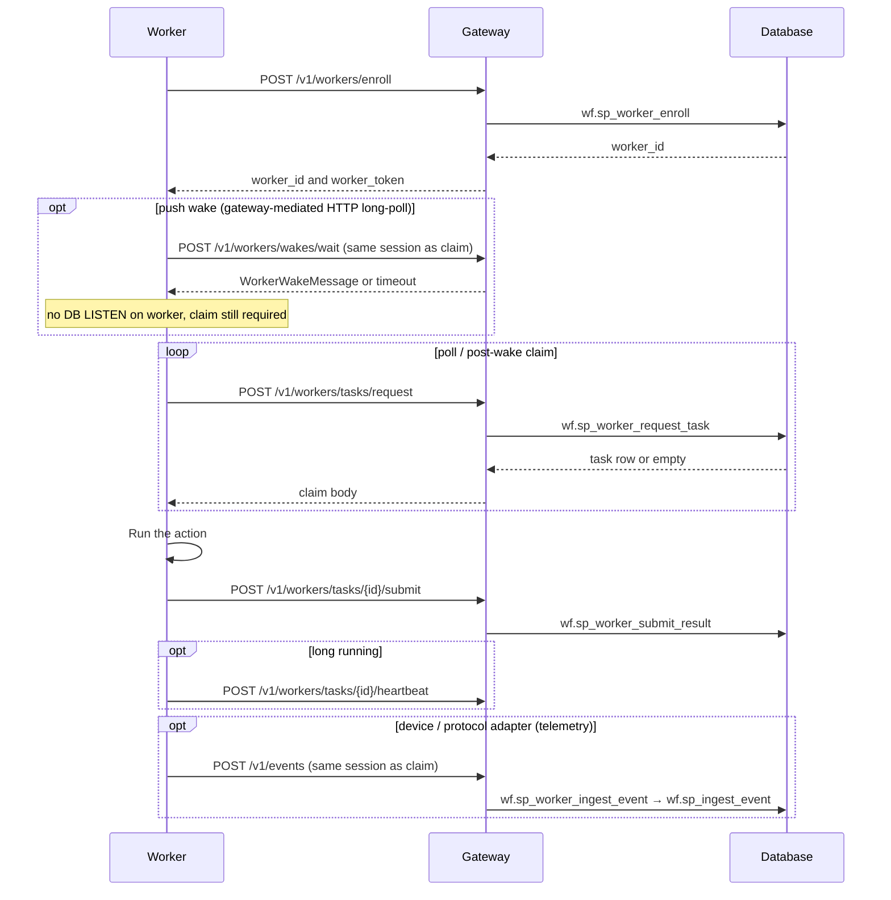

# Remote worker protocol

Language-neutral contract for workers that execute workflow ACTION nodes.
Workers use the REST API in [`../contracts/openapi.yaml`](../contracts/openapi.yaml). They do not open the database.
The client in this repository is [`../goliath_worker/client.py`](../goliath_worker/client.py). It claims and submits. It does not run an action.

## Flow

Paths below are under the `/v1` prefix the gateway serves. The OpenAPI document lists them without that prefix, and the servers block includes `/v1`.

## Enrollment

1. Insert a cluster with `portal.sp_upsert_cluster` and an allowlist row with `portal.sp_upsert_worker_enrollment(cluster_key, public_ip, external_worker_key)`. Status starts at `PENDING`.
2. From that public IP, `POST /v1/workers/enroll` with `cluster_key`, `external_worker_key`, and an optional `capabilities` array. The gateway reads the client address from the connection (or from `X-Real-IP` / the last `X-Forwarded-For` hop when the peer is a trusted proxy). It mints `worker_token` (`secrets.token_hex(32)`), stores the SHA-256 digest, and returns `worker_id` and the plaintext token once.
3. A missing allowlist row, a revoked row, or an IP that does not match the preregistered address is HTTP 403. The client in this repository does not fall back to SQL.

`goliath_worker.client.WorkflowRestClient.enroll` performs step 2. The default base URL is `GOLIATH_API_BASE` (legacy `METH` + `YL_API_BASE`), or `http://localhost:8080/v1`.

## Push wake (notify only)

Dual activation adds an optional **wake** path alongside claim. Wakes do **not** replace claim: they only hint that a worker should call `POST /v1/workers/tasks/request` sooner. **Workers receive wakes only through goliath-gateway** on **`POST /v1/workers/wakes/wait`** (long-poll, same `Authorization` + `X-Goliath-Worker-Token` + JSON `worker_id` as claim). Set **`WORKER_WAKE_HTTP=1`** to use `WorkflowRestClient.wait_idle_then_request_task`. They **must not** use Postgres `LISTEN` or a database DSN (**removed** `WORKER_WAKE_POSTGRES`, `WORKER_WAKE_PG_DSN`). See [../docs/dual-activation.md](../docs/dual-activation.md).

### Wait response

| Field | Meaning |
|-------|---------|
| `wake` | `WorkerWakeMessage` object when a matching hint arrived, or `null` on timeout. |
| `timed_out` | `true` when no wake matched before `timeout_seconds`. |

### Wake message (payload)

| Field | Required | Notes |
|-------|----------|-------|
| `wake_id` | yes | Dedup id (for example tied to event idempotency). |
| `reason` | yes | Producer label (for example `event_ingest:{event_type}`). |
| `pool` | at least one of pool, capability, `program_id` | Fleet pool / cluster key. |
| `capability` | at least one of pool, capability, `program_id` | Matches worker capability filtering on claim. |
| `program_id` | at least one of pool, capability, `program_id` | Domain program hint. |
| `event_id` | no | Source event when wake follows `POST /v1/events`. |
| `workflow_instance_id` | no | Observability only; not a lease. |
| `occurred_at_utc` | no | ISO-8601 UTC. |

Channel names: `goliath.wake.v1.pool.{pool}`, `goliath.wake.v1.capability.{name}`, `goliath.wake.v1.program.{program_id}` (see `goliath_worker.wake`).

Event adapters may include optional overrides under `payload.worker_wake`. After ingest with `applied_count > 0`, the gateway publishes wakes from subscription-derived READY work (`wf.fn_worker_wake_hints_for_event`) merged with any override. Optional **`WF_WAKE_POSTGRES=1`** enables Postgres `NOTIFY` **inside the gateway process only**; workers still receive wakes over **`POST /v1/workers/wakes/wait`**.

Subscribing to wakes **through the gateway** requires an authenticated **worker session** (same bearer session as claim). Lost wakes fall back to poll; duplicate wakes cause multiple claim attempts but at most one lease.

## Claim, submit, heartbeat, fail

| Call | Path |
|------|------|
| Open session | `POST /v1/workers/session` |
| Long-poll wake (optional) | `POST /v1/workers/wakes/wait` |
| Claim one task | `POST /v1/workers/tasks/request` |
| Submit | `POST /v1/workers/tasks/{nodeExecutionId}/submit` |
| Heartbeat | `POST /v1/workers/tasks/{nodeExecutionId}/heartbeat` |
| Fail | `POST /v1/workers/tasks/{nodeExecutionId}/fail` |

Every call except enroll sends `worker_id` and `worker_token` in the JSON body. Claim accepts optional `capability` and `max_lease_seconds` (default 300). Submit sends `result_code` and optional `output_json`.

### Capabilities

`wf.sp_worker_request_task` compares the task's `wf.workflow_action.capability` with `wf.worker.capabilities`:

| Stored capabilities | Dispatch |
|---------------------|----------|
| JSON array containing `"*"` | Any capability |
| `NULL` or `[]` | No task |
| A list of names | Only those capabilities |

The poll body's `capability` field narrows that set. It cannot add a capability the worker does not have.

### Fleet control

The claim and heartbeat bodies include `desired_state` (`ACTIVE`, `DRAINING`, `STOPPING`) and `command` (`NONE`, `DRAIN`, `STOP`). `DRAINING` and `STOPPING` return no new task. An empty poll may omit `has_task` or send a null `node_execution_id`. Treat that as idle.

Optional environment flags on the gateway:

- `GATEWAY_WORKER_IP_BIND` — when the cluster has `allowed_source_cidrs`, the client IP must fall in that list.
- `GATEWAY_REQUIRE_ARC_ATTEST` — `X-Arc-Resource-Id` must match the cluster `arc_resource_id` when one is stored. The client sends `ARC_RESOURCE_ID`, or the value in `GOLIATH_ARC_ENV` (legacy `/etc/goliath/arc.env`).

`GATEWAY_REQUIRE_ENTRA` is loaded and does not gate these routes.

## Result codes

The engine stores `result_code` on `node_execution` and selects IF and SWITCH branches with `wf.wf_try_task_result_code`. A negative code fails the workflow instance. Zero and positive codes are the branch values the graph defines for that action.

## What this repository does not do

Handler dispatch, command lines, and in-process functions belong to the specialized application. After a claim, that application runs the action and calls submit. `WorkflowRestClient` also has methods that request `POST /workflows/instances`, `GET /workflows/instances/{id}`, and `GET /actions`. The gateway in this tree does not implement those paths.

Shared storage is optional. `goliath_worker.work_share` helps when several hosts mount the same tree. A worker that never calls it does not need the mount. `scripts/init_work_layout.sh` creates the directory layout under `GOLIATH_WORK_ROOT`, `WORK_ROOT`, or `/work` when that mount already exists.
